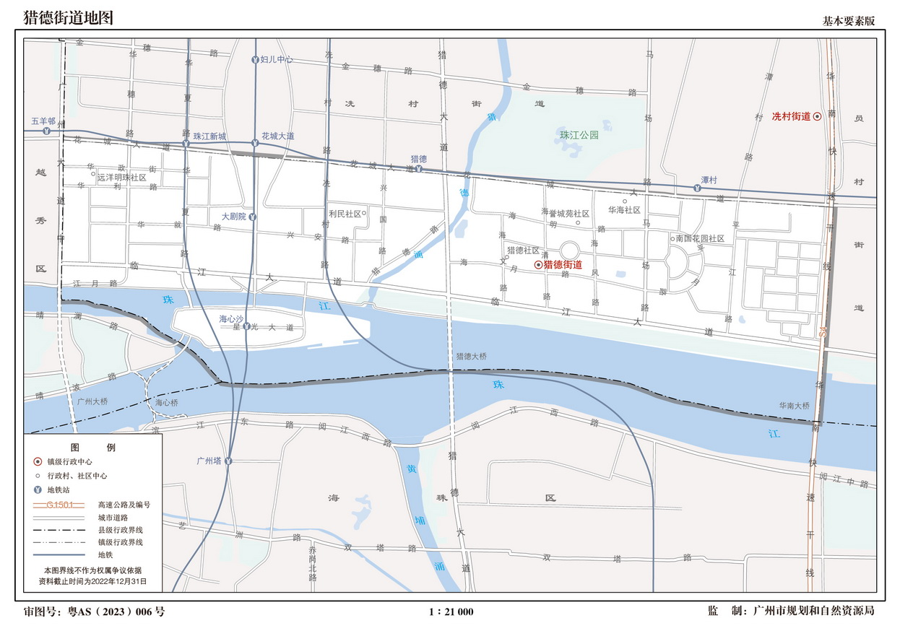

# 猎德地域定义与官方地图

核对日为2026-11-10。研究主体采用猎德街道，社区案例与国际街区分别登记。学校的行政位置、招生地段和日常通行范围分别记录。

## 已取得的地图

| 来源 | 文件与版本 | 可用信息 | 使用限制 |
| --- | --- | --- | --- |
| E015 | 2024广州市行政区划图，约28.3MB PDF | 广州市、天河区和周边行政区的位置关系 | 比例尺适合背景定位，社区细界需另核 |
| E043 | 2022猎德街道地图公开预览，1246×874像素 | 花城大道、广州大道、华南快速、珠江、海心沙及社区名称 | 图上资料截至2022-12-31，审图号粤AS（2023）006号，比例尺1∶21000 |
| E044 | 2022冼村街道地图公开预览 | 北侧相邻街道、道路和社区位置 | 同期公开预览，最新边界变化待核 |
| E045 | 2022员村街道地图公开预览 | 东侧相邻学校所在街道与道路 | 同上 |
| E046 | 2022天河南街道地图公开预览 | 体育东路、体育西路等北侧扩展片区 | 同上 |
| E016-A001 | 天河区国土空间总体规划（2021—2035年）公开图集，约117.9MB PDF | 区域空间规划、公共服务背景及规划图 | 发布页时间为2026-03-13，文件名含2505，规划设施与已经开办学校需分别识别 |
| E042 | 2022广州街镇地图公开目录JSON，共176条图幅记录 | 地图名称、地区、图幅编号和公开图片名称 | 查询2024同类目录返回空列表，目录结果不足以判断平台所有新版本均不存在 |

原网址、SHA-256、下载时间和完整本地路径见[来源索引](来源索引.md)与[下载清单](下载清单.csv)。地图预览通过平台正常公开图片地址归档，预览分辨率与用于出版的原图分开标注。平台完整图件下载入口有登录要求，本包保存公开预览及可公开取得的PDF。

## 三种地域口径

| 单元 | 已核资料 | 研究用途 |
| --- | --- | --- |
| 猎德街道 | E041年鉴正文回顾2012年，PDF第443页记约3.2平方公里，东起华南快速、南到珠江、西到广州大道中、北至花城大道。E043可见街道与相邻街道、海心沙及珠江区界。E023的2026报道继续采用3.2平方公里 | 主体机构清单及公共服务配置研究 |
| 猎德社区 | E018的2025政府门户介绍记约0.55平方公里，东起海清路、西至猎德大桥、南眺珠江、北靠花城大道 | 可作细尺度社区案例，文本四至与正式社区边界仍需核验 |
| 猎德国际街区 | E019英文官方介绍采用约3.5平方公里 | 国际化服务背景，单独保存面积与服务对象口径 |

E041链接中的201805是归档路径信息，正文包含2012年统计和事件。因此，年鉴人口、社区数量及设施均按历史材料使用。街道南界应结合江中区界和海心沙理解，沿江道路提供陆上参照。使用地图时保留完整图例、来源、版本和审图信息。

## 本轮学校位置的纳入办法

1. **主体已有官方归属**。2022基本情况表明确列为猎德街道，现址与2026名单交叉吻合。幼儿园包括猎德园、第二实验珠江新城园区、金穗花城园区。华文园由2025报道明确位于猎德街利民社区，2026名录核其兴民路227号现址。
2. **更新的民办街道归属**。E058-A001为2026发布的2025年度最终年检表，明确海滨、合美粤广、力迅上筑、汇悦天启、海月路爱乐、启赋等6园属猎德街道。候选表已据此补齐归属，校门和具体社区边界继续定位。
3. **周边地址候选**。向冼村、天河南、员村扩展，保存兴国、冼村、天河中学花城、天河外国语珠江新城等学校。猎德大道上的学校按官方所在街道核对。
4. **招生关系补充**。华颖、华师附中等有正式对口或派位关系的对象，附关系依据及更远位置标签。

本轮整理了30条幼儿园候选和20条小学初中校区学段候选。它们构成继续核验的地址名录。1公里、2公里缓冲尚未完成坐标筛选，数量分析需先完成这一环节。美林海岸、体育东、天河东等较远候选均保留扩展标签，后续可据同一距离标准决定纳入范围。

## 空间分布可以如何解释

- 西部利民片区有华文幼儿园和启赋幼儿园两处相邻地址，分别为2026名录中的国企办园和普惠性民办园，适合观察同一片区的不同制度入口。
- 中东部猎德、海月路、上筑街、南国花园和平江路片区可比较教育部门办园、民办普惠园以及九年一贯学校的组合。
- 北侧冼村街有兴国小学、冼村小学及天河中学花城校区等对象，与街内学校有招生联系。
- 初中对口关系跨越社区和街道。地图中的附近学校需结合小学毕业资格、户籍及申请渠道分析。

以上为已核地址与政策形成的空间描述。学校密度、供需缺口和居民实际通学时间仍分别缺少精确空间边界、同年适龄人口、实际路线资料。

## 后续点位与路线记录

每个办学点需补校门位置、地图坐标及坐标体系、定位来源、当前街道和社区、校门到公共起点的路线。两社区可先调查猎德社区与利民社区，正式比较对象仍依课程指定范围核实。

两名组员在同一时段记录步行路线、过街设施、红绿灯、围墙绕行和公告位置。地图直线距离、步行距离、家长实际接送时间分别保存。跨珠江学校的路线加入桥梁或公共交通换乘。学校地址在相邻行政区时另核当地申请规则。
