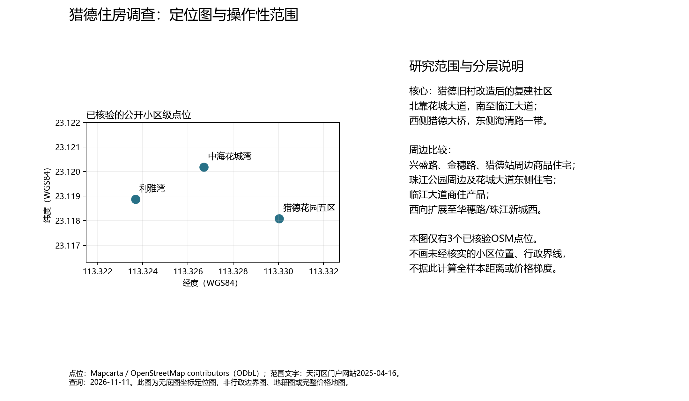
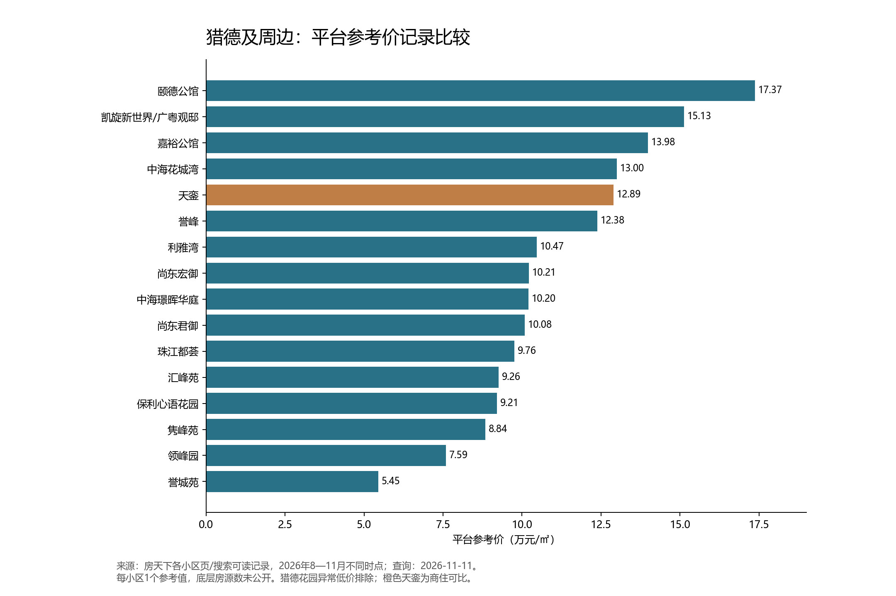
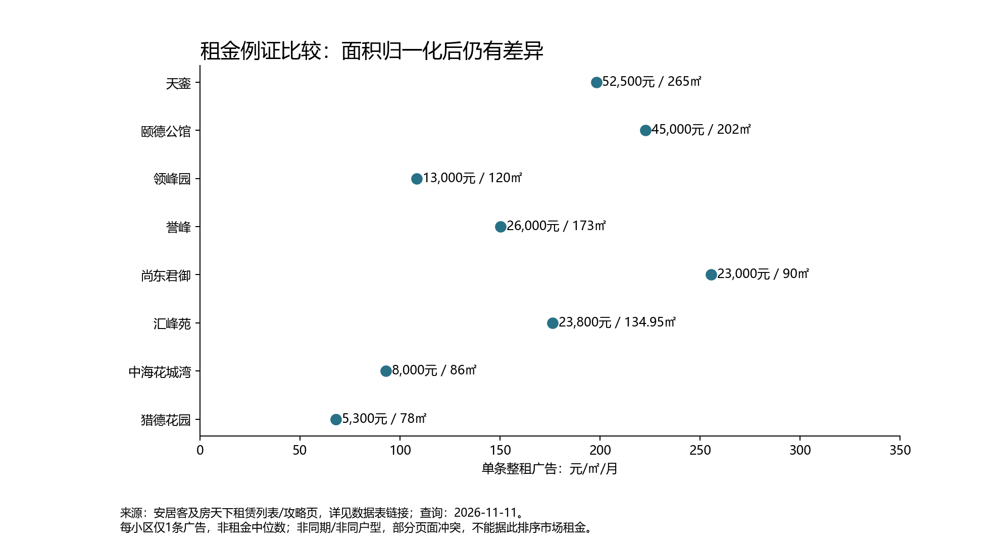

# 广州猎德村及周边住宅价格空间分布调查

**2026-11-12补充说明：**关于区域命名、同月价格比较和政策性租赁项目，请同时阅读[区域房价分析补充报告](猎德区域房价分析补充报告_2026-11-12.md)。原先近邻“西侧”组应理解为“站区中西组（含站北）”；新增官方公告确认誉城苑2026年有10套人才公寓纳入配租、标准50元/㎡/月（不含物业费），只适用指定房源及合资格申请人。以下原始价格记录仍按2026-11-11冻结版本保留。

查询基准日：2026年11月11日（北京时间，UTC+8）。用途：UCUG3801《Social Inequality and Social Mobility》田野调查的住房背景研究。研究者：资料整理辅助。版本性质：公开资料桌面调查，不包含尚未实施的实地观察或访谈，不是房产估价报告。

## 1. 当前证据能支持什么

本次建立了17个小区的目的性比较清单，覆盖猎德复建社区、猎德站周边、珠江公园周边、临江大道商住产品及西侧可比住宅。非回迁的16个小区参考值为54,455—173,681元/㎡，小区等权中位数102,072.5元/㎡；再排除天銮商住产品后，15个小区中位数为102,011元/㎡。这些数字是**不同月份、不同页面的参考值记录摘要**，不能称为“2026年11月猎德成交均价”。完整逐小区表、逐条链接、挂牌面积、总价和租金见附录及Excel。

最重要的发现有三项：第一，猎德的住房分层同时涉及空间位置和住房权利，回迁复建房与市场商品房必须分开研究。第二，附近商品住宅本身存在明显价格差异，但现有资料不能识别地铁、景观、楼龄、教育预期各自的净影响。第三，平台价格存在显著口径与版本冲突，价格本身就是需要现场核验的对象。

住房与教育的连接，应研究“哪些住房权利和居住证明使家庭进入哪一种招生程序”，而不是用高房价替代入学资格，更不能用挂牌价格替代住户收入或社会阶层。

## 2. 地理范围：三个不能混同的概念

“猎德村”指历史村落及其城市更新关系。“猎德社区”是当前社区治理单元。“猎德街道”是范围更大的街道行政单元。“珠江新城”则是城市规划与市场区位概念。平台“珠江新城中/东”是商业分区，不能据此确定街道归属。

天河区门户2025年4月16日发布的资料，将猎德社区描述为主要由旧村改造后的复建安置房小区构成，范围大体东到海清路、西到猎德大桥、南临临江大道、北靠花城大道，面积约0.55平方千米。这个范围适合做本研究的**核心社区操作边界**，但不等于旧村全部历史土地，也不是已取得的地籍矢量边界。[来源：天河区门户/南方+](https://www.thnet.gov.cn/thdt/mtjj/content/post_10216558.html)

本调查采用四层比较：

|层次|操作定义|典型观察对象|选择原因|
|---|---|---|---|
|核心复建区|上述社区范围内的猎德花园等复建住宅，现场再核分区与入口|猎德花园|连接旧改、安置、住房资产和租赁市场|
|猎德站及相邻商品住宅|花城大道、猎德大道、兴盛路、兴国路、金穗路一带|中海花城湾、保利心语、汇峰苑、领峰园、尚东君御等|交通与CBD区位接近，适合比较楼龄、面积、产品及产权|
|东侧/公园/临江比较|珠江公园周边、花城大道向东与临江大道一带|凯旋、誉峰、颐德、尚东宏御、誉城苑、天銮|观察高价产品与较早住宅并存，检验景观与产品差异|
|西侧扩展比较|西向延伸至华穗路、珠江新城西的公共道路沿线|珠江都荟，后续补华穗路实地样本|检验猎德核心之外的可比住房，而不是把它称为猎德村|

建议下一轮以猎德站出入口为起点建立0—500米、500—1000米、1000—1500米步行距离组，再在确实超出范围的小区加“扩展对照”标记。**本轮未取得完整同坐标系点位或步行路网，所以尚未实际执行缓冲圈筛选和距离回归。**这些距离组是待执行方案，不能写成已完成测量。

本次定位图仅绘出3个已核验OSM小区级点位：猎德花园五区（23.11808, 113.33004）、中海花城湾（23.12019, 113.32671）、利雅湾（23.11888, 113.32368）。五区点位只代表五区，不能代表整个猎德花园中心。凯旋另有公开地图坐标，但坐标系未核实，已从WGS84图中排除。其余坐标留空。[五区](https://mapcarta.com/W616267312)、[花城湾](https://mapcarta.com/W515737466)、[利雅湾](https://mapcarta.com/W206602237)。

图1：无底图坐标定位图，仅呈现已核验点位；不是行政边界图或完整价格地图。OSM贡献者数据，查询2026-11-11。

## 3. 方法与取证标准

采用分层目的性选样，优先覆盖住房制度、街区与价格差异。样本不是随机抽样，不能推断全体住宅价格分布。每个小区摘录一个平台参考值及尽可能一条出售、出租例证；这是一轮预调查，**并未做到每小区系统抽取多套可比房源**。

价格分成四种：平台小区参考值、单条出售挂牌、平台标示的成交记录、租赁广告或整租均价。单价计算采用总价万元×10,000÷建筑面积；租金单价采用月租÷广告建筑面积。套内面积不能替代建筑面积。小区等权中位数的分母是小区参考记录数，不是成交住宅套数。平台显示“在售316套”等数值可能包括重复、撤牌未更新或不同产品，不当作独立样本量。

本次网络工具包括搜索服务返回的可读片段与正文打开。附录中的17个参考记录主要来自可读搜索结果，部分页面经正文复核。**搜索可读不等于已保存原始网页，也不等于已电话核实在售。**正文与摘要冲突时保留初始值作为检索版本，并把差异写入下文，避免暗中覆盖。未采集个人联系人、电话号码、单元或房号。

|平台/资料|本轮取得情况|用途和限制|
|---|---|---|
|房天下|多小区参考记录、单条挂牌、租赁列表、5条完整价格成交记录|主要价格来源；底层样本和算法不透明，部分页面相互冲突|
|安居客|公开整租列表中取得猎德花园及花城湾例证|列表可读，未逐条核实房源编号与有效性；不能认为安居客独立核验过房源|
|链家|中海花城湾资讯页正文可读|更新时间为空、成交均价字段缺值，推荐房源随读取变化；作为质量核验，不纳入同月统计|
|贝壳|小区页返回明确访问限制|未取得有效小区价格；遵守限制，没有绕过验证|
|诸葛找房|广州页面未能读取，检索未取得可核条目|缺失，不据其名义引用数字|
|58同城爱房|花城湾历史序列可读|作为另一平台口径的对照；摘要与正文版本不一致|
|住建、教育、区门户及期刊|政府统计目录、2026招生细则、边界人口资料、学术全文可读|核验背景与制度；不替代房源登记价格|

查询日统一为2026-11-11。本轮未保存每个网络请求的精确时分秒，因此不补造“抓取时间”；文件校验时间单独记在统计说明JSON中。源页所写的9月/11月、房源“发布日”和搜索引擎“若干天前抓取”是三个不同时间概念。

## 4. 城市更新与住房制度

《热带地理》2020年研究记载，猎德在2007年开始整体拆迁改造、2010年完成回迁，复建社区由37栋高层组成。该研究基于2011—2018年的跟踪材料，讨论了租赁、就业、社会网络与市民化之间并不一致的变化。它支持“物质居住条件改善不能自动等同社会融入”的解释，但不能当作2026年的住户画像。[期刊全文](https://www.rddl.com.cn/CN/abstract/article/1001-5221/48775)

天河区委社会工作部2024年发布资料列出的猎德社区户籍人口为7,880余人、居住人口20,300余人。它是当时发布口径，不应与2018年的学术统计直接相减来计算人口增长，更不能借人口总数推断某个小区租户收入。[2024年官方社区资料](https://www.thnet.gov.cn/thdt/bmjd/content/post_9737459.html)

|住房类型|本轮有何证据|如何处理|
|---|---|---|
|回迁复建房|学术与官方社区资料确认猎德复建社区；房天下问答称猎德花园为集体产权，与基本信息栏“70年”并存|确认复建背景；不把平台问答当作2026年全小区登记结论。逐栋/逐套权利状态须查合法公开材料|
|普通商品住宅|多平台小区页列住宅、开发商、70年等|记录为“平台分类”，不能代替不动产权证。70年通常涉及住宅用地使用年限，不能解释为房屋所有权仅70年|
|商住/公寓产品|天銮平台列商住楼、50年及商业性质|单列产品比较。公寓是营销/建筑称谓，不能由名字确定用地、落户或招生资格|
|保障性住房|本轮未核实研究范围内具体保障房项目及价格|不因价格低就归为保障房；不以回迁房替代保障房|

猎德花园页面出现6,009元/㎡参考价，单条“48㎡、23.6万元”广告对应约4,917元/㎡，还出现年代、户型等值得疑问的信息。这只能证明公开广告如此标示，不能证明普通买家可按此价格取得正常商品房产权。其所售权利、期限、转让限制、房源位置及真实性均未核实，因此**从商品住宅价格统计中剔除**。[平台小区页](https://www.fang.com/xiaoqu/gz-2811925416/)、[异常广告例证](https://m.fang.com/esf/gz/3_512197047.html)

## 5. 价格空间分层及其解释

图2：不同月份的小区参考值比较。来源为附录各房天下页面及搜索可读记录，时点2026年8—11月，查询2026-11-11。每小区1个值、底层房源数未知。猎德花园剔除，天銮以不同颜色表示商住产品。

|观察事实|可能机制|证据限制|
|---|---|---|
|誉城苑参考记录54,455元/㎡，颐德173,681元/㎡，相差约3.19倍|同属邻近CBD范围仍可能因楼龄、户型、景观、物业和住房制度产生分层|月份不同，平台估算不等于成交；不能说所有房源相差3.19倍|
|猎德站西侧的领峰园75,876、汇峰苑92,574、中海花城湾130,034元/㎡存在差异|“接近地铁”是共同条件之一，不能充分解释全部价格差|没有控制户型、楼层、朝向、有效房源数量|
|东侧公园周边既有较高参考值，也有较早低价社区|景观资源与产品定位可能形成局部高价集聚，但周边并非均质豪宅区|尚无完整地理点位与相同日期样本，无法做空间自相关检验|
|同小区挂牌与参考值可相差很大|算法口径、户型结构、税费车位条件、议价及广告质量可能共同作用|无法仅凭差异判断“市场暴跌”或“业主急售”真实程度|

现有证据更适合称为**相邻社区之间的产品与制度分层**，不足以证明“从猎德村向外围价格单调上升/下降”。研究区中西侧均有高价与相对低价住宅，地理距离不是唯一维度。

楼龄信息也需谨慎：花城湾链家资讯页称2004年、房天下称2007年，个别广告另写2005年；可能涉及分期、开工/竣工/交付口径，也可能是错误。回迁背景资料显示2010年回迁，平台却常标猎德花园2009年。报告保留平台年代作为待核变量，不据此精确计算楼龄溢价。容积率、建筑面积等平台字段也存在明显不协调，未用于回归。

## 6. 成交证据与历史变化

公开可读的完整价格成交共5条，涉及3个小区，其中4条已在成交/小区正文复核；凯旋1条来自房天下月报可读搜索记录，正文重开超时，证据级别较弱。均为平台“市场信息”，并非取得了住建登记凭证。

尚东君御2026年6月27日一套49.50㎡房源列总价300万元、单价60,607元/㎡；它只能说明该平台记录了一笔小户型成交。[成交记录](https://m.fang.com/chengjiao/gz/EX_1760885.html)

颐德公馆2026年公开3条完整价格记录的单价中位数126,123元/㎡，范围123,834—133,662元/㎡。同一正文另列2024年11月11日170.58㎡成交单价199,320元/㎡。两条同面积记录并不能确认同一套房，不能计算重复交易房价指数，最多提示需继续核查价格调整。[成交列表正文](https://m.fang.com/xiaoqu/gz/2812041162.html)

凯旋2026年9月月报可读记录列262.77㎡、3,080万元，复算约117,213元/㎡，比当月151,268元/㎡参考值低约22.5%。这不是可识别的“议价率”：成交房与参考价所代表的住宅并不匹配。月报还出现“1900年建成”等错误字段，应提高核验标准。[月报来源](https://m.fang.com/news/gz/13202_55158412.html)

住建局目录已更新到2026年10月存量房交易登记信息，发布日期2026年11月9日；统计正文的图片本轮未成功读取，未引用其中套数或均价。该资料也不能提供猎德小区级成交价格。[官方统计](https://zfcj.gz.gov.cn/xysj/fwxx/clfjydjtjxx/content/post_11092298.html)

## 7. 租金证据与租售关系

图3：有面积分母的8条整租例证，非同户型、非同期随机样本；来源见附录二。查询2026-11-11。点值不表示小区租金均值或中位数。

猎德花园78㎡、5,300元/月广告对应67.95元/㎡/月；花城湾86㎡、8,000元/月对应93.02元/㎡/月。两者提供了共享CBD区位下不同租赁支出的例证，但装修、户型与真实性仍需核验，不能凭两条广告推断所有回迁房与商品房的租金差。[猎德例证列表](https://gz.zu.anjuke.com/rmss/zhengzu-102-tianhe/)、[花城湾例证列表](https://gz.zu.anjuke.com/rmss/zhengzu-42-l37/)

高端小区整租总价往往还受到大面积影响。比较应同时列“月租总额”和“单位面积租金”。只比较总月租会把面积结构误读成纯价格差。汇峰苑、尚东君御、颐德等攻略或列表中出现较高租金，某些同名房源在其他页面报价不同；本轮将其作为审计线索，未估计小区租金中位数。

本轮不计算租售收益率。正确的毛收益率应使用同套或严格匹配房源的月租×12÷购买总价，并区分空置、管理费、税费等。把回迁房异常“出售”低价与整租广告组合会产生误导性收益率。

## 8. 平台冲突台账

|对象|本次检索差异|采用办法|
|---|---|---|
|花城湾58价格页|搜索摘要称2026-11为131,556.54；正文打开后显示2026-10为123,308.88，页面首部又有122,088|不把11月摘要写为已正文确认值；不与房天下9月值做同期涨跌比较|
|颐德公馆|初始搜索小区页173,681；手机正文重开显示179,369，周报显示其他时段价格|保留初始记录，注明多版本；不选择最高值代表最新价格|
|花城湾链家资讯|搜索摘要推荐房源与正文重开房源不同；更新时间为空，参考成交均价缺值|不纳入定时点统计，不能用“上月成交77套”当可验证成交样本|
|保利心语单条广告|部分页面总价标题、正文文字存在不同报价|优先用所见数值分别留存；同一面积不同广告不能自动视为不同房源|
|猎德花园|70年字段、集体产权问答、异常低售价格并存|制度和广告质量待核；低价不进入商品房排序|

原网址：[58花城湾](https://mfang.58.com/gz/xinfang/xq100456221/fangjia/)、[链家花城湾](https://news.lianjia.com/gz/xiaoqu/2111103319096.html)、[颐德正文](https://m.fang.com/xiaoqu/gz/2812041162.html)。历史趋势应在下一轮保存同一页完整截图/合法导出，并核实算法变化后再分析。

## 9. 与教育机会的有限接口

2026年天河义务教育细则把户籍、完全房产与实际居住证明相联系，并区分地段生、统筹生和积分入学等路径。对小学，地段资格还涉及学位占用；体育东路小学兴国学校等存在特定购房时间与学位容量排序规定。初中还涉及小学学籍、毕业小学对口及返区/跨地段程序。因此住房金额只能代表一种支出或资产门槛，不能直接推出录取结果。[2026年官方通知及附件](https://www.thnet.gov.cn/gzjg/qzf/qjyj/zsks/content/post_10791180.html)

教育部门办幼儿园按2026方案实行相应招生规则，小区配套园对符合条件的本区户籍小区业主子女有优先安排机制，并受计划、派位影响；其他性质幼儿园须另查办园与收费文件。[2026幼儿园方案](https://www.thnet.gov.cn/gzjg/qzf/qjyj/tzgg/qtgg/content/post_10776807.html)

租房家庭能否进入某类申请程序，还需核实合法租赁备案、无房等适用条件，不能把租赁信息采集表当作备案证明。天河教育局2024年答复明确区分二者；这只是历史政策解释，2026具体期限须以当年附件和学校审核为准。[官方答复](https://www.thnet.gov.cn/thdt/bmjd/content/post_10038150.html)

本次不发布逐小区学校对口表，避免将平台“附近学校”或地理距离误当招生地段。下一轮应把官方2026招生地段中的地址与小区具体公开门牌逐项匹配，再核产权、户籍、学位占用与申请程序。非穗籍家庭还应核验积分和可申请学位，付得起附近租金并不自动取得同一路径。[2026积分入学录取说明](https://www.thnet.gov.cn/gzjg/qzf/qjyj/zsks/content/post_10885658.html)

## 10. 社会学解释：观察事实—可能机制—证据限制

**Spatial inequality（空间不平等）**：观察事实是相邻街区的价格、产品和居住成本不同；可能机制是住房市场把交通、环境、服务与居住支出联系起来，使家庭拥有不同区位选择集。证据限制是价格没有揭示实际居住者的资产、家庭构成与可支配收入，且本轮尚无系统观察。

**Social reproduction（社会再生产）**：可能机制是已有住房资产、继承/安置权利、稳定居住能力与制度信息，影响家庭跨代获得教育申请资格、时间稳定性及额外教育支出的能力。应把它写成待验证的转化过程，而不是“买贵房必然上好学校”。本轮缺家庭教育经历与产权材料，不能证明因果链已经成立。

可补充“住房资产与居住成本的分离”：原权利人可能通过安置取得住房，租户通过持续支付租金获得居住使用，购房者通过市场支出取得资产，三者进入同一片区的路径不同。原村民内部、业主内部和租户内部都可能存在差异，不能统一贴上“富裕”“外来”“低收入”等标签。

## 11. 下一次踏查：把预调查变成三类证据

建议以两段路线执行，均在公共道路观察，实际耗时与通行条件现场记录。

路线A（核心与邻近比较）：猎德站公开出口集合→花城大道与猎德大道路口→中海花城湾公共道路外侧→猎德花园公共入口外侧/猎德涌沿线→临江大道→誉城苑公共道路外侧。目标：记录交通与街区环境相近时，回迁复建与较早住宅的差异。避免进入需门禁许可的内部空间。

路线B（产品与西侧比较）：猎德站→兴盛路（汇峰、隽峰、领峰）→金穗路保利心语外侧→冼村路/花城大道嘉裕公馆外侧→西向华穗路、珠江新城西公开广告点。若当日时间有限，东侧珠江公园—凯旋—颐德另做第三段，不把远距离样本挤在一次短观察中。

每站填写：日期起止时间、天气、观察点、建筑/门禁/公共通道、维护情况、公共租售广告数量、可见面积与总价、是否整租、步行到地铁与学校的实际用时、过街障碍、资料来源和照片编号。同类型站点尽量早晚各观察一次。不要从路人的衣着、口音或职业外观猜测身份。

价格审计建议每小区采集至少3—5条同一日期的60—90㎡两居或90—120㎡三居广告，记录房源编号并去重；大平层另组。至少两家门店/两平台交叉核验，但不要因为跨平台出现就当成两套房。保留完整报价条件：建筑面积、挂牌/成交、装修、车位、税费、楼层、朝向、发布日期和最近调价日。

经同意可向经纪或管理方核验：这条广告出售的是什么权利？普通买家能否登记过户？价格是否含车位/税费？房源仍有效吗？近三个月同面积成交能提供匿名公开依据吗？整租报价是否含管理费、是否可备案、租约期限如何？回迁房现时不同楼栋权利状态是否一致？不要索取住户名字、身份证、个人收入、房号或未公开家庭资料。

学校/街道核验问题：该公开地址在2026哪一招生范围？所需居住证明是什么？回迁拆迁协议如何审核？合法承租家庭适用哪条程序？是否统筹而非对口？学位占用适用期限与例外是什么？下一年预警是否改变安排？记录文件名称及年份，不采集儿童信息。

课程三类证据中，本轮完成的是背景研究与线上价格预审计；系统观察、现场价格审计和可选匿名交谈仍待开展。不得把这份报告写成已完成田野观察。

## 12. 主要局限

1. 目的性选样偏向网上可见、商品化程度较高的社区，尚缺稳定的小户型、公寓、低价租赁与保障房对照。
2. 参考值时间不一致且算法不透明，不能代表当月成交水平。搜索摘要与正文不一致进一步降低可比性。
3. 逐小区只摘录少量广告，无法估计各小区房源中位数；广告存在重复、虚假、过期和捆绑条件。
4. 成交仅5条平台记录，未取得登记凭证，缺同套匹配；不支持因果估计或连续年度房价指数。
5. 完整小区点位、路网和行政边界缺失，未计算空间自相关、步行缓冲和地铁距离效应。
6. 产权分类多依赖平台元数据；尤其回迁与商住权利需正式文件复核。
7. 未调查家庭资产、收入、实际招生经历，不可从房价推断居民阶层或教育结果。

## 13. 参考文献与证据链接（Harvard式简化）

所有网页检索日期为2026年11月11日。以下为背景主文献；逐小区平台链接在附录和Excel中逐项提供。

- UCUG3801课程教学团队（2026/27 Fall）《Group Poster Assessment: Liede: Reading Mobility and Inequality in Place》，用户提供课程PDF，11页。已读取全文；当前交付仅为调查，不制作海报。
- 潘卓林等（2020）《基于场域理论的城中村村民市民化研究——以广州猎德复建房社区为例》，《热带地理》，40(6)。[期刊全文](https://www.rddl.com.cn/CN/abstract/article/1001-5221/48775)。作者完整序列与页码请投稿前按期刊首页再校对，不补造未核字段。
- 天河区委社会工作部（2024年6月26日）《天河区构建“一核两轮三支撑”新模式 以志愿力量赋能现代社区建设》。[官方页面](https://www.thnet.gov.cn/thdt/bmjd/content/post_9737459.html)。
- 天河区人民政府门户网站/南方+（2025年4月16日）《上榜！广州天河猎德街猎德社区获评“广东省最美志愿服务村（社区）”》。[页面](https://www.thnet.gov.cn/thdt/mtjj/content/post_10216558.html)。
- 广州市天河区教育局（2026年4月28日）《2026年天河区义务教育阶段学校招生工作细则》。[官方发布及PDF](https://www.thnet.gov.cn/gzjg/qzf/qjyj/zsks/content/post_10791180.html)。
- 广州市天河区教育局（2026年4月20日）《2026年广州市天河区幼儿园招生工作方案》。[官方发布](https://www.thnet.gov.cn/gzjg/qzf/qjyj/tzgg/qtgg/content/post_10776807.html)。
- 广州市住房和城乡建设局（2026年11月9日）《2026年10月存量房交易登记统计信息》。[目录与正文](https://zfcj.gz.gov.cn/xysj/fwxx/clfjydjtjxx/content/post_11092298.html)。本次仅验证标题和发布日期，图片数据读取失败，未引用数值。
- 链家（无可核发布日期）《广州中海花城湾房价怎么样？》。[页面](https://news.lianjia.com/gz/xiaoqu/2111103319096.html)。只作为页面质量核验，不纳入当月均价。
- 58同城爱房（动态页面）《中海花城湾房价走势》。[页面](https://mfang.58.com/gz/xinfang/xq100456221/fangjia/)。版本冲突见台账。
- Mapcarta/OpenStreetMap contributors（动态页面）猎德花园五区、中海花城湾、利雅湾公开小区级点位。链接见第2节；原数据遵循ODbL。

---

以下附录由交付数据表同源生成，保留原始检索记录与缺失。报告中出现的机制解释不得当作附录数据中的已测变量。

## 附录一：逐小区价格记录

以下表格为搜索服务可读记录的冻结整理，不是经纪核实房源清单。参考月份与房源发布日期必须分别使用。参考值的底层样本数均未核实；有总价/面积的每行各摘录1条广告。缺失以“—”表示。

|小区|地址|平台参考价（元/㎡）|参考月份|挂牌总价（万元）|挂牌面积（㎡）|挂牌单价（元/㎡）|挂牌时点|来源|
|---|---|---:|---|---:|---:|---:|---|---|
|猎德花园（以五区公开点位代表）|猎德大道20号|6009|2026-10|23.6|48|4917|2026-09-30|[小区页](https://www.fang.com/xiaoqu/gz-2811925416/) / [挂牌证据](https://m.fang.com/esf/gz/3_512197047.html)|
|保利心语花园|金穗路70号|92115|2026-11|588|76.3|77065|2026-08-08|[小区页](https://www.fang.com/xiaoqu/gz-2811166106/) / [挂牌证据](https://m.fang.com/esf/gz/8_1023948172.html)|
|中海花城湾|花城大道86号|130034|2026-09|930|124.25|74849|2026-11-04|[小区页](https://www.fang.com/xiaoqu/gz-2811113500/) / [挂牌证据](https://m.fang.com/esf/gz/3_264820073.html)|
|汇峰苑|兴盛路8号|92574|2026-09|1450|203.66|71197|2026-11-03|[小区页](https://www.fang.com/xiaoqu/gz-2811598942/) / [挂牌证据](https://m.fang.com/esf/gz/3_511042431.html)|
|凯旋新世界/广粤观邸|清风街（花城大道与海风路一带）|151268|2026-09|1578|204.87|77024|查询页2026-11|[小区页](https://www.fang.com/xiaoqu/gz-2811048273/) / [挂牌证据](https://www.fang.com/xiaoqu/gz-2811048273/)|
|尚东君御|兴盛路与冼村路交界G3-1|100810|2026-09|658|91.27|72094|查询页2026-11|[小区页](https://www.fang.com/xiaoqu/gz-2811218224/) / [挂牌证据](https://www.fang.com/xiaoqu/gz-2811218224/)|
|嘉裕公馆|花城大道80号|139796|2026-11|2075|198.99|104277|查询页2026-11|[小区页](https://www.fang.com/xiaoqu/gz-2812000566/) / [挂牌证据](https://www.fang.com/xiaoqu/gz-2812000566/)|
|誉峰|金穗路711号|123788|2026-11|—|—|—|缺失|[小区页](https://www.fang.com/xiaoqu/gz-2811103725/) / [挂牌证据](https://www.fang.com/xiaoqu/gz-2811103725/)|
|隽峰苑|兴盛路10号|88402|2026-08|1100|232.61|47289|查询页2026-11|[小区页](https://www.fang.com/xiaoqu/gz-2811279062/) / [挂牌证据](https://www.fang.com/xiaoqu/gz-2811279062/)|
|领峰园|兴盛路7号|75876|2026-09|600|152.67|39300|查询页2026-11|[小区页](https://www.fang.com/xiaoqu/gz-2811451064/) / [挂牌证据](https://www.fang.com/xiaoqu/gz-2811451064/)|
|利雅湾|兴民路160号|104708|2026-08|1380|153|90196|查询页2026-11|[小区页](https://www.fang.com/xiaoqu/gz-2811067802/) / [挂牌证据](https://www.fang.com/xiaoqu/gz-2811067802/)|
|珠江都荟|珠江新城西、近五羊邨站|97610|2026-11查询页|861|125.99|68339|2026-11-07|[小区页](https://m.fang.com/esf/gz_xm2811687538/?projcodes=2811687538&purpose=) / [挂牌证据](https://m.fang.com/esf/gz/3_512748019.html)|
|尚东宏御|花城大道760号|102134|2026-09|900|135.98|66186|查询页2026-11|[小区页](https://www.fang.com/xiaoqu/gz-2811185782/) / [挂牌证据](https://www.fang.com/xiaoqu/gz-2811185782/)|
|颐德公馆|花城大道126—136号（双号）|173681|2026-11|1660|170.58|97315|查询页2026-11|[小区页](https://www.fang.com/xiaoqu/gz-2812041162/) / [挂牌证据](https://www.fang.com/xiaoqu/gz-2812041162/)|
|中海璟晖华庭|猎德大道33号|102011|2026-09|780|133.95|58231|查询页2026-11|[小区页](https://www.fang.com/xiaoqu/gz-2811184582/) / [挂牌证据](https://www.fang.com/xiaoqu/gz-2811184582/)|
|誉城苑|临江大道（海清路一带）|54455|2026-09|530|86.1|61556|查询页2026-11|[小区页](https://www.fang.com/xiaoqu/gz-2811405752/) / [挂牌证据](https://www.fang.com/xiaoqu/gz-2811405752/)|
|天銮|临江大道59号之一至之七|128902|2026-09|2140|213|100469|查询页2026-11|[小区页](https://www.fang.com/xiaoqu/gz-2811895580/) / [挂牌证据](https://www.fang.com/xiaoqu/gz-2811895580/)|

## 附录二：租金记录

|小区|月租（元）|面积（㎡）|按月租÷面积复算（元/㎡/月）|口径|来源|
|---|---:|---:|---:|---|---|
|猎德花园（以五区公开点位代表）|5300|78|67.95|单条广告|[证据页](https://gz.zu.anjuke.com/rmss/zhengzu-102-tianhe/)|
|中海花城湾|8000|86|93.02|单条广告|[证据页](https://gz.zu.anjuke.com/rmss/zhengzu-42-l37/)|
|汇峰苑|23800|134.95|176.36|单条广告|[证据页](https://m.fang.com/zf/gz_xm2811598942/?jhtype=zf&purpose=%E4%BD%8F%E5%AE%85)|
|尚东君御|23000|90|255.56|单条广告|[证据页](https://m.fang.com/xiaoqu/strategy/gz/2811218224.html)|
|嘉裕公馆|17800|—|—|平台整租均价，底层n未知|[证据页](https://m.fang.com/xiaoqu/strategy/gz/2812000566.html)|
|誉峰|26000|173|150.29|单条广告|[证据页](https://m.fang.com/zf/gz_xm2811103725/?projcodes=2811103725)|
|隽峰苑|8500|—|—|平台整租均价，底层n未知|[证据页](https://m.fang.com/xiaoqu/strategy/gz/2811279062.html)|
|领峰园|13000|120|108.33|单条广告|[证据页](https://m.fang.com/xiaoqu/strategy/gz/2811451064.html)|
|颐德公馆|45000|202|222.77|单条广告|[证据页](https://m.fang.com/xiaoqu/strategy/gz/2812041162.html)|
|中海璟晖华庭|12250|—|—|平台整租均价，底层n未知|[证据页](https://m.fang.com/xiaoqu/strategy/gz/2811184582.html)|
|天銮|52500|265|198.11|单条广告|[证据页](https://m.fang.com/xiaoqu/strategy/gz/2811895580.html)|

## 附录三：公开平台成交记录

|小区|日期|总价（万元）|面积（㎡）|平台单价（元/㎡）|来源|
|---|---|---:|---:|---:|---|
|凯旋新世界|2026-09-02|3080|262.77|117213|[市场信息，非登记凭证](https://m.fang.com/news/gz/13202_55158412.html)|
|颐德公馆|2026-06-30|2280|170.58|133662|[市场信息，非登记凭证](https://m.fang.com/xiaoqu/gz/2812041162.html)|
|颐德公馆|2026-02-03|2150|173.62|123834|[市场信息，非登记凭证](https://m.fang.com/xiaoqu/gz/2812041162.html)|
|颐德公馆|2026-01-22|2780|220.42|126123|[市场信息，非登记凭证](https://m.fang.com/xiaoqu/gz/2812041162.html)|
|尚东君御|2026-06-27|300|49.5|60607|[市场信息，非登记凭证](https://m.fang.com/chengjiao/gz/EX_1760885.html)|

## 附录四：可复算统计

- 非回迁参考值（含天銮商住）：n=16，中位数=102,072.5元/㎡，算术平均=109,885.25元/㎡，范围=54,455—173,681元/㎡。
- 进一步排除天銮商住：n=15，中位数=102,011元/㎡，算术平均=108,617.47元/㎡。
- 中位数对小区等权，每小区只计一个参考值，未按住宅套数/成交量加权；不是全区住宅单套中位数。
- 颐德公馆2026年3条公开平台成交：单价中位数126,123元/㎡，范围123,834—133,662元/㎡；样本结构不足以代表整个小区。
- 不计算全样本租售比：出售与出租不是同一套房、时间与户型不匹配。租金例证只执行月租÷广告建筑面积。
- 整理校验完成时间（UTC+8）：2026-11-11T23:29:26+08:00。网页实际检索发生于2026-11-11本次会话；未保存逐请求精确时分秒，故不补造抓取时刻。
