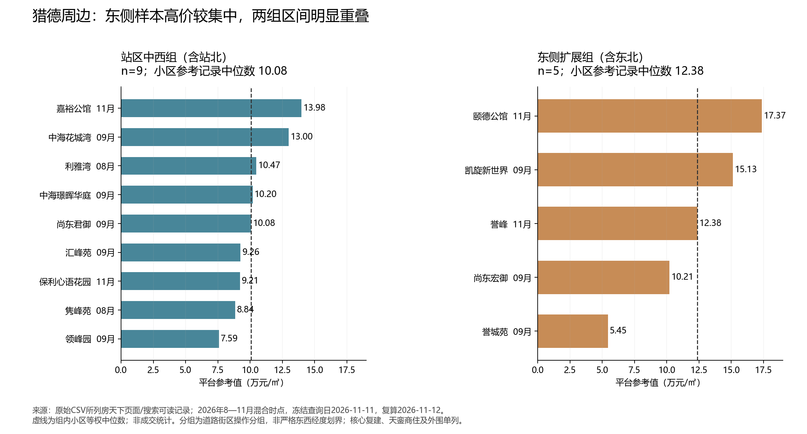
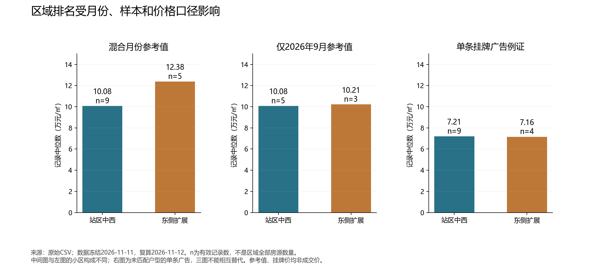

# 猎德住房价格与区域关系：分区统计补充报告

原始数据冻结查询日：2026-11-11。补充浏览、区域复算与成文：2026-11-12（北京时间）。本报告复用原始17小区预调查记录，并补充一项官方人才公寓证据；没有把旧记录改写为11月12日最新价格。

## 1. 最适合目前证据的区域总结

**东侧扩展组的高价商品住宅参考记录较集中，站区中西组呈中高价混合；核心复建组的重点是住房权利与租赁使用，暂不能放进同一出售价格等级。**这是一份目的性小样本的描述，不能概括研究区全部住宅。

|操作分组|小区数|平台参考记录中位数（万元/㎡）|范围（万元/㎡）|可采用的区域描述|
|---|---:|---:|---:|---|
|核心复建组：猎德花园|1|不纳入|不列|复建与租赁社区；异常售房广告所涉权利未核，不能简单称低价区|
|站区中西组（含站北）|9|10.08|7.59—13.98|中高价混合，内部存在高价住宅|
|东侧扩展组（含东北）|5|12.38|5.45—17.37|高价样本较集中，但内部差异大，包含较低参考值的誉城苑|
|西侧外围单列：珠江都荟|1|9.76|单条|扩展对照，不能据一小区概括珠江新城西部|
|临江商住单列：天銮|1|12.89|单条|产品制度另列，不代表临江住宅整体|

这里的“高、中、低”只指本次样本相对位置，没有用广州全市住宅分布作为基准；“中高价混合”也不是政府分级。表中小区数不是底层房源数。按小区等权计算，没有按套数或建筑面积加权。

## 2. 区域怎样划分，怎样避免方向误导

先前把9个小区简称“西侧”过于宽泛，本报告改称**站区中西组（含站北）**。它沿兴盛路、兴民路、花城大道、金穗路及猎德大道站北一带组织比较，包括中海璟晖华庭这一站北边界样本。它不是所有小区都严格位于猎德大道西侧的多边形。

东侧扩展组包括珠江公园周边、花城大道向东的既有样本以及誉城苑，含东北方向，并延伸至尚东宏御所在的东部街区。它同样不等于某个行政社区。分组目前依据公开地址与研究选样，完整同坐标系点位和步行距离尚未取得，不能声称已完成严格GIS分区。

核心复建组按住房制度界定，代表猎德花园；它也不等于整个猎德社区。天河区门户转载南方+的2025-04-16资料称，猎德社区大致东至海清路、西至猎德大桥、南临临江大道、北靠花城大道，且包含猎德花园、尚东柏悦府、天德广场等。因此不能把社区范围全部涂成复建房。[行政社区范围资料](https://www.thnet.gov.cn/thdt/mtjj/content/post_10216558.html)

中海璟晖华庭平台地址为猎德大道33号，高德列31号；可能为不同入口或门牌，本报告保留冲突，不据其精确点位计算距离。[房天下](https://www.fang.com/xiaoqu/gz-2811184582/)、[高德公开地点页](https://www.amap.com/place/B00140TYWA)

## 3. 逐小区对应表

价格是2026-11-11冻结记录，不是本次浏览全部再次复现的值；每小区一个平台参考记录，底层房源数未知。颐德与誉城苑正文重开未能按原数字检索复现，原值保留用于说明旧样本；不能据此声称实时可成交。

|操作分组|小区|公开地址|参考月份|参考值（万元/㎡）|来源|
|---|---|---|---|---:|---|
|核心复建组|猎德花园（以五区公开点位代表）|猎德大道20号|2026-10|0.60|[原始来源](https://www.fang.com/xiaoqu/gz-2811925416/)|
|站区中西组（含站北）|保利心语花园|金穗路70号|2026-11|9.21|[原始来源](https://www.fang.com/xiaoqu/gz-2811166106/)|
|站区中西组（含站北）|中海花城湾|花城大道86号|2026-09|13.00|[原始来源](https://www.fang.com/xiaoqu/gz-2811113500/)|
|站区中西组（含站北）|汇峰苑|兴盛路8号|2026-09|9.26|[原始来源](https://www.fang.com/xiaoqu/gz-2811598942/)|
|东侧扩展组（含东北）|凯旋新世界/广粤观邸|清风街（花城大道与海风路一带）|2026-09|15.13|[原始来源](https://www.fang.com/xiaoqu/gz-2811048273/)|
|站区中西组（含站北）|尚东君御|兴盛路与冼村路交界G3-1|2026-09|10.08|[原始来源](https://www.fang.com/xiaoqu/gz-2811218224/)|
|站区中西组（含站北）|嘉裕公馆|花城大道80号|2026-11|13.98|[原始来源](https://www.fang.com/xiaoqu/gz-2812000566/)|
|东侧扩展组（含东北）|誉峰|金穗路711号|2026-11|12.38|[原始来源](https://www.fang.com/xiaoqu/gz-2811103725/)|
|站区中西组（含站北）|隽峰苑|兴盛路10号|2026-08|8.84|[原始来源](https://www.fang.com/xiaoqu/gz-2811279062/)|
|站区中西组（含站北）|领峰园|兴盛路7号|2026-09|7.59|[原始来源](https://www.fang.com/xiaoqu/gz-2811451064/)|
|站区中西组（含站北）|利雅湾|兴民路160号|2026-08|10.47|[原始来源](https://www.fang.com/xiaoqu/gz-2811067802/)|
|西侧外围单列|珠江都荟|珠江新城西、近五羊邨站|2026-11查询页|9.76|[原始来源](https://m.fang.com/esf/gz_xm2811687538/?projcodes=2811687538&purpose=)|
|东侧扩展组（含东北）|尚东宏御|花城大道760号|2026-09|10.21|[原始来源](https://www.fang.com/xiaoqu/gz-2811185782/)|
|东侧扩展组（含东北）|颐德公馆|花城大道126—136号（双号）|2026-11|17.37|[原始来源](https://www.fang.com/xiaoqu/gz-2812041162/)|
|站区中西组（含站北）|中海璟晖华庭|猎德大道33号|2026-09|10.20|[原始来源](https://www.fang.com/xiaoqu/gz-2811184582/)|
|东侧扩展组（含东北）|誉城苑|临江大道（海清路一带）|2026-09|5.45|[原始来源](https://www.fang.com/xiaoqu/gz-2811405752/)|
|临江商住单列|天銮|临江大道59号之一至之七|2026-09|12.89|[原始来源](https://www.fang.com/xiaoqu/gz-2811895580/)|

图1：两组小区参考记录分布。虚线为小区等权中位数；月份混合，非成交统计。来源：上述逐项链接及原始CSV，2026年8—11月记录；查询2026-11-11，复算2026-11-12。

## 4. 不应遗漏的敏感性分析

|比较口径|站区中西组中位数|东侧扩展组中位数|可以解释到哪里|
|---|---:|---:|---|
|混合月份平台参考值|10.081万元/㎡，n=9|12.3788万元/㎡，n=5|东组记录中位数高约22.8%；混合月份、产品结构与选样共同作用|
|只取2026年9月参考值|10.0810万元/㎡，n=5|10.2134万元/㎡，n=3|差距约1.31%；同月后小区构成也改变，不能解释为时间调整后的净溢价|
|单条出售挂牌记录|7.2094万元/㎡，n=9|7.1605万元/㎡，n=4|次序不再是东高；未匹配面积、户型与房源质量，也不能替代参考值|
|东组剔除誉城苑|—|13.7528万元/㎡，n=4|中位数明显上升，显示只选高端社区会改变结论|

9月站区中西组为花城湾、汇峰苑、尚东君御、领峰园、中海璟晖；东组为凯旋、尚东宏御、誉城苑。**现有数据不足以证明稳定的“东侧比西侧贵23%”。**可以报告这批混合月份记录的差值，但不能把它写成区域因果效应或已知市场规律。9月小样本接近也不能反证真实区域差异不存在。

图2：更换时间筛选和价格口径后的记录中位数。三组比较不是同质价格指数，也不是同一套房变化。来源与日期同图1；n为有效记录数。

## 5. 租金与制度：新增官方证据

天河区住建园林局2026-08-13《关于受理天河区人才公寓申请的公告》列出本批次100套房源，其中**誉城苑10套**（两房6套、三房4套），位于海清路；租金标准**50元/㎡/月，不含物业管理费**，合同期限不超过3年，续租仍需符合条件。公告对人才类别、学历或职称、替代年薪条件及家庭无自有产权住房等设置门槛。[官方公告](https://www.thnet.gov.cn/thqzdlyxxgkzl/zfbz/bzxzffphtcxx/content/post_10965824.html)

这是指定房源配租标准，10是公告供应套数，不是10条已成交市场租赁记录；公告也不能证明查询日仍有空置房源。不能将50元/㎡/月当作整个誉城苑市场租金，不将其与其他小区单套广告求共同中位数，更不能把人才公寓等同于面向所有低收入家庭的公租房。

这项证据补充并更新原报告“尚未核实范围内具体政策性租赁项目”的缺口：现已确认誉城苑存在上述批次人才公寓。原始CSV的市场房源属性不因此整体改变，全小区不能统一归为政策房。

与之并列的预调查广告有猎德花园78㎡、5300元/月（67.95元/㎡/月）、花城湾86㎡、8000元/月（93.02元/㎡/月）。它们只是市场广告例证，不具备政策租金的资格和期限口径。租金研究应拆分“公开市场报价”和“资格限定配租标准”。原市场租金来源分别为[安居客猎德整租列表](https://gz.zu.anjuke.com/rmss/zhengzu-102-tianhe/)、[安居客花城湾整租列表](https://gz.zu.anjuke.com/rmss/zhengzu-42-l37/)，冻结查询日2026-11-11，未作为11月12日新样本。

## 6. 观察事实—可能机制—证据限制

|观察事实|可能机制（待验证）|证据限制|
|---|---|---|
|东组有凯旋、颐德、誉峰较高参考值，也有誉城苑较低值|公园与江景可达性、开发定位、物业与户型可能形成局部集聚|未控制楼龄、景观、户型、月份；无法分解贡献，更不能直接称学区溢价|
|站区中西组7.59—13.98万元/㎡，内部跨度明显|同样邻近CBD和轨道交通，住宅产品与供给结构仍可能影响价格|不能认为同组所有单位共享相同地铁距离；未实测路网|
|核心复建背景与周边市场商品房不同|安置权利、原有资产与市场租赁可形成不同的居住进入路径|无逐套产权登记、完整租赁合同和家庭资料，不推断个体阶层|
|誉城苑部分房源按人才公寓50元/㎡/月配租|就业和人才资格可能让部分家庭通过政策渠道进入该区位|公告只适用指定房源和合资格申请人；未观察实际入住及教育申请|
|同月筛选后两组中位数接近，单条挂牌的排名也不同|初始差距可能部分源于选样、产品结构与价格口径|不能估计各因素大小，也不代表区域效应已被否定|

## 7. 怎样连接教育机会而不越过证据

可把区域价格理解为一种“进入区位的成本条件”，再把产权、户籍、实际居住和合法租赁证明理解为进入招生程序的制度条件。二者相关但不等同：租住同一片区、购买同一小区或入住人才公寓，都不能仅凭位置和价格推出学校录取结果。2026年天河招生细则明确区分相应资格与程序。[2026年天河义务教育招生通知及附件](https://www.thnet.gov.cn/gzjg/qzf/qjyj/zsks/content/post_10791180.html)

Spatial inequality可用于分析不同家庭的区位选择如何受到居住成本与资格门槛共同约束；social reproduction可用于提出“已有住房资产、安置或继承权利如何转化为稳定居住及教育申请条件”的研究问题。现有资料没有证明这种转化在具体家庭中已经发生。

下一轮优先比较：①猎德花园租赁进入路径；②站区中西组低、中、高参考值各选一小区；③东组凯旋或颐德与誉城苑形成同片区对照；④核实人才公寓合同可提供何种合法居住材料及其适用招生程序。向公共服务机构核对公开规则，不收集居民证件、家庭收入或儿童个人资料。

## 8. 可复核方法与下一轮补数

原始数据为17小区CSV；新增逐小区分组CSV保留原25个字段并增加操作组、纳入状态和说明。统计CSV逐口径列n、中位数、均值、最小与最大值。中位数为排序后中央值（偶数取中央两值均值），缺失挂牌记录不填零；核心异常出售记录和天銮商住均不混入两组常规住宅比较。租金没有估计区域总体中位数。

建议下一轮每组至少覆盖3—5个小区，每小区在同一周系统记录多套不同面积段的独立房源，保存可核的房源编号、面积、报价、日期、楼层与装修等字段，并去除跨平台重复；具体数量应依有效房源覆盖与课题时间调整。先完成去重与同户型比较，再决定是否计算面积匹配中位数。至少补齐同坐标系小区入口点位，才可按猎德大道、花城大道或步行缓冲区进行严格划分。

主要局限：目的性选样覆盖不完整；原始参考月份不一致；部分记录仅搜索可读且页面动态冲突；产权分类未经逐套登记验证；没有完整空间坐标及现场审计；挂牌与租金例证未匹配户型。故本报告展示区域联系与需要检验的假说，不发布精确区域估价或因果模型。

## 9. 本轮浏览与版本记录

2026-11-12补充浏览：官方人才公寓公告（正文可读，发表2026-08-13）、猎德社区范围资料（正文可读，发表2025-04-16）、高德中海璟晖公开地点页（搜索可读）、中海璟晖及尚东宏御房天下页面（搜索可读）、保利心语房天下页面（搜索可读）；另重开颐德、誉城苑正文，原价格数字未能全文检索复现，未更新为新值。复核时刻约北京时间09:34，自动精确生成时间见同目录JSON。网站动态变化意味着后续点击可能看到不同版本。

本补充报告与原报告并读；区域命名及政策性租赁项目以本次明确补充为准，原始CSV与原XLSX保持冻结版本。区域数据不应被标注成完整实际成交价格地图。
