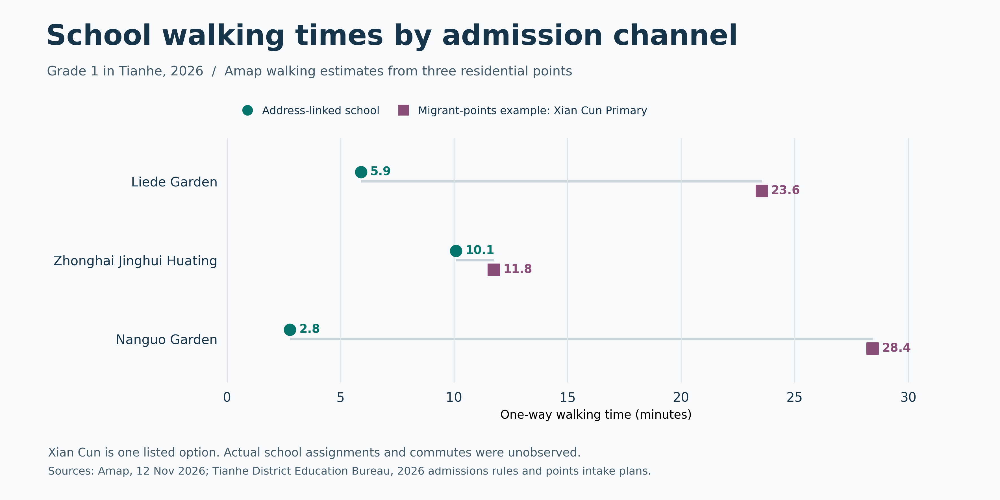

# 猎德教育资源交通可达性调查

UCUG3801 · Social Inequality and Social Mobility · 三轮调研结论

[完整证据与方法](evidence.md) · [39 条路线记录](appendix/route-tables.md) · [Poster 成稿](#academic-poster)

## 核心结论

> **Physical proximity does not necessarily translate into equal educational access.**
>
> 学校在地理上的接近，并不必然意味着不同家庭具有平等的教育机会。

学校分布与招生规则共同决定哪些学校路线与家庭有关。同一住址的家庭可以因适用的招生渠道不同，面对不同的可申请学校和潜在交通成本。现有证据支持申请范围和相关路线的差异。家庭最终获录取的学校、实际费用和接送负担仍未知，因此无法估计实际教育机会不平等的程度。

## 三个研究发现

### Finding 1 · 三处住宅附近都有较近的教育设施，空间优势随目的地而变

下表为高德地点到地点的单程步行估计，单位为分钟。

| 住宅 | 最近幼儿园（原六园区） | 最近公办幼儿园（原六园区） | 地段对应小学 |
|---|---:|---:|---:|
| 猎德花园 | 3.6 | 3.6 | 5.9 |
| 中海璟晖华庭 | 3.6 | 8.5 | 10.1 |
| 南国花园 | 6.5 | 8.6 | 2.8 |

猎德花园到最近公办样本园用时最短，南国花园到各自地段对应小学的比较中用时最短。三个点的相对优势随学校位置和类型变化，无法据此给回迁住宅和商品住宅做整体排序。第三轮补查了 K7 和 K8 两个公办园区。南国花园到 K7 的路线返回异常，表中 8.6 分钟仅指原六园区内的最近公办园。 [小学地段对照](evidence.md#小学地段与招生渠道) · [幼儿园基准与补查](evidence.md#最近园区及扩展核查) · [路线附表](appendix/route-tables.md)

### Finding 2 · 招生制度改变家庭可申请的学校范围

三个住宅的地段对应小学，分别是各自原四所样本小学中最近的一所。2026 年天河区来穗人员随迁子女积分入学的十所公办小学与原四所没有交集。户籍、住房产权、租赁备案和积分等条件决定哪些招生渠道适用。以积分名单上的冼村小学为例，南国花园到地段对应小学约 **2.8 分钟**，到冼村小学约 **28.4 分钟**，按未舍入时间计算相差约 **25.7 分钟**。 [2026 年天河区小学招生细则](https://www.thnet.gov.cn/attachment/8/8016/8016210/10791180.pdf) · [积分公办小学计划摘录](data/round-3/primary-migrant-points-plan-2026.csv) · [三个地址的渠道对照](evidence.md#同一住址在不同招生渠道下的步行时间)

冼村小学只是积分渠道的一个可填志愿。图中的路线差反映列明学校的潜在交通成本，实际分配学校和家庭通学时间仍未知。 [Poster 主图](#academic-poster)

### Finding 3 · 步速与接送安排会改变可达性估算

原 30 条高德步行用时与「路网距离 ÷ 1.25 米／秒」的最大差为 0.4 秒。用较慢步速重算原六园区，可见 10 分钟覆盖对假设敏感。 [敏感性分析](evidence.md#101520-分钟覆盖与步速敏感性) · [阈值数据](data/round-3/threshold-sensitivity.csv)

| 步速情境 | 10 分钟内至少有一个公办样本园的住宅 |
|---|---:|
| 高德基准，约 1.25 米／秒 | 3／3 |
| 假设 1.00 米／秒 | 1／3 |

**接送成本情境。** 如果一条路线每单程多 10 分钟，按每天走两段、每周五天计算，就会多 100 分钟。若家长早晚均从住所出发并返回，每天走四段，则多 200 分钟。校门、过街等待和工时安排可能让这笔时间更难吸收。模型未测量这些家庭约束，也未观测不同群体的接送差异。 [累计接送情境](evidence.md#每周接送负担情境) · [情境数据](data/round-3/commute-burden-scenarios.csv)

## 社会学解释

**Spatial Accessibility → Institutional Accessibility → Practical Accessibility → Educational Opportunities**

| 层次 | 社会学概念 | 证据与解释 |
|---|---|---|
| Spatial Accessibility | Spatial Inequality | 住宅和园校位置形成不同的步行距离。现有路线支持三个样本点的空间比较。 |
| Institutional Accessibility | Social Stratification | 户籍、产权、租赁备案及积分规则可以改变家庭的可申请学校范围。区级文件支持这些渠道差异。 |
| Practical Accessibility | Economic Capital | 可动用的经济资源可能影响家庭能否承担费用，接送还受时间和日程约束。现有数据只能模拟部分交通负担。 |
| Educational Opportunities | Social Reproduction | 若上述差异长期影响可选学校和实际就读，可能成为家庭优势代际延续的机制。现有研究尚未验证阶层间的录取、就读或教育质量差异。 |

## 两个尚未解决的问题

1. **实际教育机会的差异有多大？** 已有路线、申请规则、部分学位计划和模拟接送成本。仍需要同一住址下不同申请渠道家庭的匿名记录，将申请和录取学校、实付费用、接送路线及安排联结起来。
2. **样本覆盖会怎样改变最近距离和比较结果？** 优先核实南国花园到 K7 的可通行人行门及接送园门。现有三个住宅和有限园校适合做案例比较，无法代表整个猎德地区的家庭。

现阶段可以收束路线研究。若继续补证，优先核实这两项。 [证据限制与实地核查](evidence.md#下一步优先核查)

## Academic Poster

**Finding 1 — Proximity varies by location and destination.**

The sampled residences have relatively short routes to some nearby educational facilities, but spatial advantages differ across destinations.

**Finding 2 — Admission rules reshape accessible school choices.**

Different admission channels may connect families at the same location to different sets of schools, creating potential differences in travel burden.

**Finding 3 — Practical accessibility depends on household constraints.**

Walking speed, school gates, escort responsibilities, and family schedules may influence whether geographically accessible schools are practically convenient.

*2026 Amap one-way walking estimates. Xian Cun Primary is one listed migrant-points option. Actual school assignments and commutes were unobserved.*

其他图表和完整的招生渠道对照供答辩查阅。 [支持图表](evidence.md#支持图表) · [数据与复现](evidence.md#数据来源与复现)
