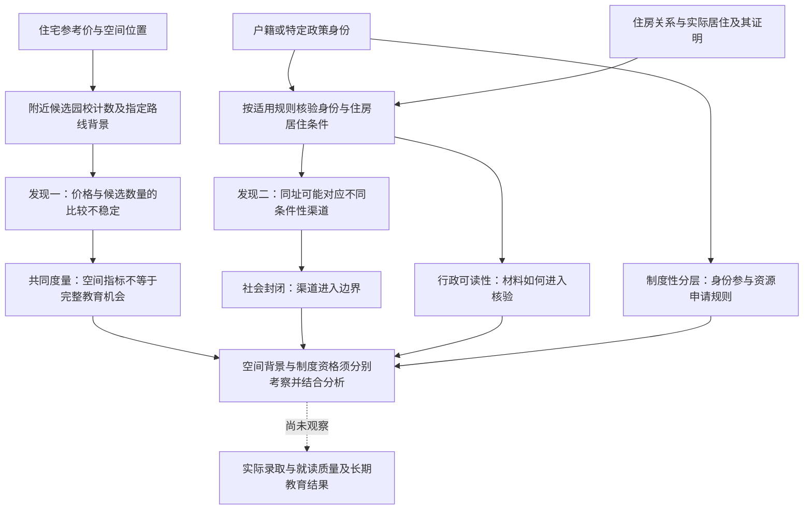

# 猎德教育机会研究：两项核心发现与理论框架

> 交接日期：2026-11-15。研究对象：猎德及周边小学与幼儿园。数据基准：仓库`0c0e50e`（2026-11-13中文交接版）。本版依据小组修改稿整合；事实核查、书目及措辞调整见[审校与引用说明](14_审校与引用说明.md)，短版见[Poster上版文案](13_Poster上版文案.md)。

## 一、核心结论

**空间接近并不足以推出教育机会。附近有什么学校，与家庭在当年规则下具备什么申请资格，需要分别考察。**

在本次样本中，较高住宅参考价未稳定对应更多附近候选园校；共享住址的家庭，也可能因户籍或特定政策身份、住房权利及有效居住材料不同而进入不同申请渠道。

连接空间与资格的关键，是**“居住如何被证明并按规则识别”**：实际居住需要通过适用材料接受核验，再关联到地段、统筹、积分或单列等程序。不同程序可能对应不同候选目的地，也可能重合。

因此，本研究提出的解释是：**空间供给提供地理背景，制度识别与资格组合关联申请路径。** 现有资料支持供给与资格的区分，尚未观察真实家庭的完整可申请集合、实际录取、学校质量和长期教育结果。

**大白话版：** 房子贵，不代表旁边一定有更多学校；就算住在同一个小区，申请办法也可能不同。还要看户口、住房和居住材料，以及适用哪条招生规则。我们查到的是部分申请条件，还没查清孩子最后去了哪里、读得怎么样。

## 二、主要发现

### 发现一：较高房价未稳定对应更多附近候选园校

本次16个同平台项目月参考价样本，以10万元/㎡作描述性分组切点：

|参考价组|项目数|300米内候选园校数中位数|500米内|800米内|
|---|---:|---:|---:|---:|
|低于10万元/㎡|7|4|7|11|
|达到10万元/㎡|9|3|6|11|

只取2026年9月，低价组n=4、高价组n=5，三个半径的比较分别为4/4、7.5/7、11/12。**比较方向对半径、月份筛选及随之变化的小区构成敏感：从混合月份低价组数量略高或相等，变为9月800米下高价组略高。** 这不表示同一批住宅随时间发生了方向逆转。

**这项发现的作用：** 对“较高价格普遍对应更多附近园校”这一简单竞争解释进行描述性核查；本样本没有提供稳定支持。它不能排除“价格—设施数量”的因果通道，更不能否定价格与学校质量、地段预期或其他教育条件的关系。

**图注及限制：** 房天下2026年8—11月混合月份项目月参考值，非成交价；距离为住宅与园校参照点间的直线距离。目的性候选清单不是设施完整普查；计数不等于学位、学校质量、个人可申请数或录取概率。[D1]

### 发现二：同一住址下，资格组合不同，申请渠道也可能不同

以南国花园为固定空间起点，2026年政策材料可组织四种条件性情境：

|家庭情境|需同时核查的条件示例|申请渠道与目的地证据|
|---|---|---|
|满足完整地段条件的家庭|相应户籍、符合要求的住房关系、实际居住、学位占用等|条件性地段对应南国学校小学部|
|符合条件的穗籍私房租户|适用户籍、无房、唯一居住地、符合当年期限的租赁备案等|相应统筹程序；实际去向未知|
|获准来穗积分申请人|申请审核、积分排序、当年计划与志愿等|冼村小学是名单内一个志愿例，非实际分配|
|通过港澳单列审核的申请人|特定方案资格、积分及名额等|方案指定南国学校小学部，仍受程序与名额约束|

这里用**“合取式资格”**概括同一条适用路径中多项条件需同时核验的特点；这是本研究的分析术语，不是法律名称或既有独立理论。具体条款仍可能有替代证明、例外和分支，不能把全套政策一概写成纯粹的“且”。不满足某条路径，不等于自动转入所谓“下一档”。[D2、P1—P3]

**路线例证：** 南国花园到南国学校小学部为166秒（约2.8分钟），到冼村小学为1706秒（约28.4分钟），两条指定路线原始时间差约25.7分钟。它是潜在路线成本差，不是两类家庭实际负担的平均差，更不是已测得的“租金”。[D3]

**指定路线排序改变：**

|住宅起点|各自条件性地段对应小学：秒／约分钟|三起点中排序|同一积分名单志愿例冼村小学：秒／约分钟|三起点中排序|
|---|---:|---:|---:|---:|
|猎德花园|354／5.9|2|1413／23.6|2|
|中海璟晖华庭|605／10.1|3|705／11.8|1|
|南国花园|166／2.8|1|1706／28.4|3|

地段列是三个不同目的地，志愿例列是同一个目的地。首尾排序改变说明：**以什么学校作为比较目的地，会改变区位便利性的判断。** 不能据此断言整个积分渠道都产生同样排序，或已排除距离的作用；恰恰是目的地变化使相关距离变化。[D3]

**两项发现的连接：** 猎德花园没有纳入同口径销售参考价比较，但有条件性地段对应小学路线。不能将其称为“低价房也有近校”的价格反例。另据仓库细则OCR第41页附件5第56项，猎德实验学校小学部地段同时列有誉城苑海清路3—19单号、颐德公馆花城大道126—136双号等；两项目原参考记录约5.45与17.37万元/㎡。这提示同一地段可包含不同参考价项目，**不能由项目价格单独反推家庭资格或个人录取**。门牌范围须逐项核对，不能将全部项目自动纳入；OCR有转写风险，最终争议以官方原件为准。[D4]

**图注及限制：** 四种情境依据政策构造，并非四户受访家庭；所有路线为地图POI间单程估算，实际接送门、录取与通学未观察。不同渠道也可能对应同一目的地。项目价格不是家庭收入，四类情境也不是四个社会阶层的排序。

## 三、对应理论支撑（理论框架）

> **本次修订说明（2026-11-15）：** 保留前两部分的结论、两项发现及数据口径，只重写理论部分。以下保留四个有明确分工的社会学概念／研究视角；它们不是四个彼此独立、均已得到因果验证的理论模型。理论用于解释证据的社会学含义，发现本身仍须由数据与政策材料支持。英文均为解释性转述和本组应用，不是原著逐字引文。

### 框架总览：四个视角分别解释哪一环

|理论／研究视角|主要对应|直接衔接的证据|在本研究中承担的解释任务|
|---|---|---|---|
|Espeland与Stevens：共同度量|发现一；连接发现二|住宅参考价分组与附近候选园校计数；同址不同渠道|澄清“价格、附近设施数、申请资格”为何不能当成同一个机会指标；不解释或预测相关系数的方向|
|Weber：社会封闭|发现二|同一地址的地段、统筹、积分、港澳单列条件性情境|识别不同申请渠道的进入边界，说明空间接近为何不能替代资格条件|
|Scott：行政可读性|发现二|实际居住与户籍、产权、租赁备案等适用材料的核验|解释居住事实如何被转换为可审核的行政记录，区别“住在那里”与“能够按规则证明”|
|Wu与Treiman／Wu：户籍制度性分层|发现二；连接核心结论|穗籍租户、来穗积分、港澳单列等不同身份与政策条件|把上述边界放回中国公共资源分配的制度背景，解释为何户籍或政策身份必须与住房条件共同考察|

**四者的关系：** 共同度量回答“我们测到的是什么”；社会封闭回答“哪些条件界定渠道入口”；行政可读性回答“这些条件如何被材料识别”；户籍制度性分层回答“中国的哪些制度身份参与了这种区分”。后三者互相补充，不是三个依次发生、已经证实的因果阶段。

### 1. 共同度量：发现一测到的是附近供给，不能据此直接替代教育机会

**作者与术语：** Wendy Nelson Espeland and Mitchell L. Stevens — *Commensuration as a Social Process*（共同度量作为社会过程）。[R5]

**理论命题。** 共同度量通过同一个指标比较不同对象。选用什么指标，会影响哪些差异进入比较、哪些差异被留在指标之外。本研究据此反思“教育机会”如何被操作化，而不是把设施计数当成不需解释的完整机会指标。

**对应发现与证据。** 发现一比较16个项目的住宅参考价与300／500／800米内候选园校数。混合月份的低／高参考价组中位数为4／3、7／6、11／11；9月子样本为4／4、7.5／7、11／12。[D1] 这些结果支持的只是：在该样本和口径下，“较高参考价对应更多附近候选园校”没有稳定呈现。发现二进一步表明，同一个空间起点仍可对应不同的条件性申请渠道。[D2]

**理论如何支撑发现。** 将校园统一计数，使不同住宅周边的设施数量能够比较，但这个数字没有包含学校质量、招生名额及某一家庭的申请资格。因此，发现一不能被改写成“贵房没有教育优势”；同样，也不能把“周边学校多”直接写成“家庭可获得的教育机会多”。共同度量视角支撑的是这种**指标与结论之间的边界**，而不是“价格与数量没有稳定关系”这一结果的成因。发现二恰好补上设施指标未包含的资格维度。

**可直接使用的分析句：**

> 附近候选园校数是空间供给指标，不等于家庭能够申请或最终进入的学校数。价格与候选数量的比较，必须与招生资格分析结合，才能进一步讨论教育机会。

**解释限度。** 该视角不预测高低价格组的计数差，也不能凭现有结果断定存在测量偏误。可达性研究仅作为辅助：计数、直线距离和指定路线时间分别测量不同方面，不合并为一个“机会分数”，也不另算第五个社会学理论。[R6]

**English author–concept–explanation–application**

- **Authors:** Wendy Nelson Espeland and Mitchell L. Stevens.
- **Concept:** *Commensuration as a Social Process*.
- **Explanation:** Commensuration compares different entities through a common metric. A metric makes selected differences comparable while leaving other dimensions outside the comparison.
- **Application to Finding 1:** Campus counts measure nearby candidate supply, not household eligibility, school quality, or actual enrolment. The perspective supports careful interpretation of the indicator; it does not explain why the observed price–count comparison changes across samples and radii.

### 2. 社会封闭：发现二的差异体现为申请渠道具有不同进入条件

**作者与术语：** Max Weber — *Social Closure*（社会封闭）。[R1]

**理论命题。** 社会关系的参与可以由规则限制，或以满足特定条件为前提。将这一概念用于招生，本组关注的是渠道的资格边界：哪些条件使申请人可以进入某项程序，哪些条件不能由住得近直接替代。

**对应发现与证据。** 南国花园四种情境固定了住址，但地段路径仍须核验相应户籍、住房关系、实际居住及学位占用等；符合条件的穗籍私房租户适用相应统筹程序；来穗积分与港澳单列又有各自审核、排序或名额规则。[D2、P1—P3] 可见，四种情境不共享一套完全相同的渠道进入条件。

**理论如何支撑发现。** 固定地址只能固定部分空间条件，不能固定规则要求的其他资格。社会封闭视角使我们把“同址不同渠道”解释为**规则划定的参与边界差异**，而非简单归结为离学校远近或房价高低。“住在学校附近”因此不足以推出“可以通过地段路径申请该校”。它不意味着四类人被划分为固定高低等级：不同路径可以指向同校，未满足某一路径也不等于自动转入另一条路径。

**可直接使用的分析句：**

> 同一地址的家庭可能面对不同的渠道进入条件。社会封闭视角揭示，招生中的空间接近只有与适用的户籍、住房及居住条件结合，才可能关联到某条申请路径。

**解释限度。** 政策列明条件，足以分析制度边界，但不能据此认定某类家长主动排斥他人、垄断学位，或已产生违法歧视与实际录取差距。原著核查定位为“基本社会学概念”§10；不把新译本页码移写给1978版。[R1]

**English author–concept–explanation–application**

- **Author:** Max Weber.
- **Concept:** *Social Closure*.
- **Explanation:** Participation in a social relationship may be restricted or made conditional by rules.
- **Application to Finding 2:** Holding the address constant does not hold eligibility constant. Catchment, coordinated, points-based, and Hong Kong/Macao-specific pathways have distinct conditions of entry. Social closure identifies these boundaries; it does not establish parental monopolization, intentional exclusion, or observed differences in admission outcomes.

### 3. 行政可读性：发现二中的居住事实，需要通过适用材料被核验

**作者与术语：** James C. Scott — *Legibility / State Legibility*（可读性／国家可读性）；本研究应用于居住的行政识别。[R3]

**理论命题。** 行政系统通过类别、记录和标准化描述识别复杂的社会情境。将这一视角用于居住核验，需要区分实际生活状况与行政程序中可被接收、核查的证明；两者有关联，却不能直接画等号。

**对应发现与证据。** 在发现二中，地段情境核查户籍、住房与实际居住等条件；符合条件的穗籍私房租户还涉及无房、唯一居住地及适用期限内的租赁备案等。[D2、P1] 因此，“确实住在南国花园”不能单独完成所有材料要求。另一方面，产权或备案材料本身也不能取代政策要求的其他核验。

**理论如何支撑发现。** 社会封闭识别“有边界”，行政可读性则解释该边界在本研究材料中**如何通过证明与审核运作**：家庭的居住关系，要以当年路径认可的材料呈现，才能接受相应审核。这使核心结论中的“实际居住—可证明材料—规则识别—条件性渠道”形成具体、可查的分析链。即使空间起点相同，行政上被核验的住房关系和材料组合也可能不同。

**可直接使用的分析句：**

> 居住在附近是生活事实，能否按相应规则证明居住则是行政审核问题。户籍、产权和租赁备案等材料，使住房关系进入招生程序；同址并不意味着材料与审核路径相同。

**解释限度。** 这里解释的是文件化识别，不是认定申请人的材料都存在困难，也不是认为行政机关只看证件。核实居住、协助补正、替代材料和例外仍可能存在；材料准备成本、被拒原因及执行差异尚无真实家庭访谈支持。

**English author–concept–explanation–application**

- **Author:** James C. Scott.
- **Concept:** *Legibility / State Legibility*.
- **Explanation:** Administrative systems make complex social circumstances recognizable through categories, records, and standardized descriptions.
- **Application to Finding 2:** Living at an address and documenting residence under the applicable rules are different matters. This study uses legibility to examine how hukou, property, and lease records enter eligibility verification. It does not assume that documents exhaust administrative knowledge or that documentary difficulties have been observed among actual households.

### 4. 户籍制度性分层：发现二须同时考察制度身份与住房条件

**作者与术语：** Xiaogang Wu and Donald J. Treiman；Xiaogang Wu — *Hukou-based Institutional Stratification / Institutional Analysis of Social Stratification*（以户籍为基础的制度性分层／社会分层的制度分析）。这是对相关研究取向的概括，不称为两位作者共同命名的独立理论。[R7、R8]

**理论命题。** 中国社会分层研究不能只考察市场资源，也需要考察户籍等制度安排如何参与资源与生活机会的分配。该研究取向提示：居住或参与城市市场，并不自动回答一个人适用何种公共资源申请规则。

**对应发现与证据。** 四情境中，符合条件的穗籍私房租户、获准来穗积分申请人和通过港澳单列审核的申请人，须分别依据适用方案判断。[D2、P1—P3] 这些差异不能仅由该地址的房价解释；同样，也不能仅由“有房／无房”概括。港澳单列属于特定政策身份及方案，不能不加区分地归入城乡户籍二分。

**理论如何支撑发现。** 此视角将发现二放到**制度身份参与机会分配**的背景中：住在同一个小区，仍须分别核验户籍或政策身份与住房、居住条件的组合。它因此支持“购买能力或地理位置不能单独推出申请路径”的解释。地方政策是这一应用的直接证据，历史户籍研究提供理解方向；两者不能互相替代。

**可直接使用的分析句：**

> 住房的市场位置与家庭的制度身份共同构成申请背景。户籍制度性分层视角说明，住进同一区域并不自动消除资格差异；具体路径仍取决于当年政策如何识别身份、住房与实际居住。

**解释限度。** Wu与Treiman（2004）使用历史时期数据，不能直接证明2026年猎德四情境的结果。当前材料识别的是规则差异，尚不能估计户籍的独立效应，也不能把四类情境排成四个社会阶层，更不能据此证明代际再生产已经发生。[R7、R8]

**English author–perspective–explanation–application**

- **Authors:** Xiaogang Wu and Donald J. Treiman; Xiaogang Wu.
- **Research perspective:** *Hukou-based Institutional Stratification / Institutional Analysis of Social Stratification*.
- **Explanation:** Institutional arrangements, including hukou, participate in the distribution of resources and life chances. This label summarizes a research perspective rather than a separately named theory coined by these authors.
- **Application to Finding 2:** Administrative or policy status must be examined together with housing and residence conditions. Historical hukou research provides context; the 2026 local policies establish the particular pathways. The study does not identify an independent hukou effect or treat Hong Kong/Macao policy status as equivalent to the historical rural–urban distinction.

### 四个视角如何共同支撑核心结论

**第一步：用发现一界定我们实际测量的空间背景。** 候选园校计数没有稳定随参考价升高而增加。共同度量视角提醒：这个计数仅是一个供给指标，不能被扩写成教育机会的全部内容；也不能据此宣称价格不重要。

**第二步：用发现二识别计数以外的制度维度。** 南国花园同址情境表明，规则中存在不同渠道条件。社会封闭将其概念化为参与边界；行政可读性解释这些边界如何涉及材料核验；户籍制度性分层把制度身份纳入中国公共资源分配的分析。

**第三步：谨慎连接路径与潜在空间成本。** 南国花园到南国学校小学部和冼村小学的指定路线分别约2.8与28.4分钟，说明选取的目的地不同，地理便利性的判断会不同。[D3] 但积分情境中的冼村小学只是一个志愿例，统筹去向未知，港澳单列目的地还可能与地段校重合。因此只能提出“条件性路径所关联的目的地可能改变潜在通学成本”，不能认定某类家庭已经多走25.7分钟。

图注：本组依据[D1—D3、P1—P3]及[R1、R3、R5、R7、R8]构建的分析关系图，2026-11-15。箭头用于组织变量和解释任务，不代表已识别的因果效应；四个视角并非共同提出过这一现成模型。“合取式资格”仍为本组的操作化术语。

**整合后的理论分析段（可供交接使用）：**

> 两项发现共同说明，教育机会不能只用房价或学校距离来代替。共同度量视角帮助界定发现一：附近候选园校计数只是空间供给指标，不包含学校质量、家庭资格和实际录取。发现二进一步显示，在同一地址下，申请路径仍与户籍或政策身份、住房关系及有效居住材料的组合有关。社会封闭解释渠道的进入边界，行政可读性解释居住如何被材料核验，户籍制度性分层则把这些差异放回制度身份参与公共资源分配的背景。因此，现有研究支持“空间背景与制度资格应结合分析”，尚不能认定某类家庭已获得更好的学校或已实现代际优势。

**大白话版：**

> 我们先数了附近有多少学校，但“有学校”不等于“你家能申请”。就算住同一个小区，还得看适用什么招生规则、材料能不能满足要求。四个理论分别帮我们讲清楚：数学校能说明多少、申请入口有什么条件、居住怎么证明，以及为什么户口或政策身份也要一起看。现在还没查到真实家庭最后去了哪所学校，所以不能直接说谁已经占了优势。

**Integrated explanation — English version**

> The findings distinguish spatial supply from institutionally defined eligibility. Commensuration clarifies why nearby campus counts cannot stand for educational opportunity as a whole. At the same address, admission pathways may still differ with administrative or policy status, housing relationships, and accepted residence evidence. Social closure identifies entry boundaries; state legibility examines documentary recognition; hukou-based institutional stratification provides context for status-related allocation rules. Actual admission, school quality, and intergenerational outcomes remain unobserved.

**课程与证据的衔接。** 课程第2讲的生活机会及第4讲的制度性分层讨论提供背景；不将以上四项都标称为课件明确讲授的独立理论。空间不平等（*spatial inequality*）可作为研究的问题意识，但本组未完成全域资源普查；社会再生产（*social reproduction*）只作为进一步追问，因为尚无跨代、长期或实际教育结果证据。课程定位及原始出处见[审校与引用说明](14_审校与引用说明.md)。

**删减说明。** 蒂利的机会囤积与布迪厄的资本转换移出主框架：前者需要群体控制资源、限制他者及持续收益等证据；后者需要家庭资源、策略与转换过程等证据。现有资料未观察这些过程，保留为主要解释容易超出证据。其他户籍背景作者也不再逐一铺陈；原参考表[R2、R4、R9—R12]保留追溯用途，不表示本版仍以其支撑主要结论。

**主要参考与核验范围。** 编号沿用[审校与引用说明](14_审校与引用说明.md)，避免与数据、政策引注脱节。本轮理论页面复核日期为2026-11-15；未新增价格、政策执行或家庭访谈数据。

- [R5] Espeland, W. N., & Stevens, M. L. (1998). Commensuration as a social process. *Annual Review of Sociology, 24*, 313–343. [期刊书目与摘要](https://www.annualreviews.org/content/journals/10.1146/annurev.soc.24.1.313)。本版仅使用摘要支持的概念范围；指标应用为本组分析。
- [R1] Weber, M. (1978). *Economy and Society*. University of California Press. [出版社再版书目](https://www.ucpress.edu/books/economy-and-society-2/paper)。概念文字沿用前轮2019新译本§10核验，不冒称本轮重读原著，也不跨版本补造页码。
- [R3] Scott, J. C. (1998). *Seeing Like a State: How Certain Schemes to Improve the Human Condition Have Failed*. Yale University Press. [出版社2020再版页](https://yalebooks.yale.edu/book/9780300246759/seeing-like-a-state/)。沿用前轮书目及预览核验；本轮复核出版社页，不声称已全文阅读。
- [R7] Wu, X., & Treiman, D. J. (2004). The household registration system and social stratification in China: 1955–1996. *Demography, 41*(2), 363–384. [机构书目与摘要](https://researchportal.hkust.edu.hk/en/publications/the-household-registration-system-and-social-stratification-in-ch/)。历史研究，不作2026地方政策的替代证据。
- [R8] Wu, X. (2019). Inequality and social stratification in postsocialist China. *Annual Review of Sociology, 45*, 363–382. [期刊书目与摘要](https://www.annualreviews.org/content/journals/10.1146/annurev-soc-073018-022516)。用于制度分析的研究背景，不声称已核全文的所有机制。
