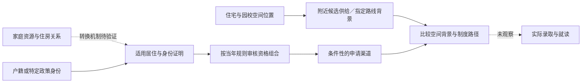

# 猎德教育机会研究：两项核心发现与理论框架

> 交接日期：2026-11-15。研究对象：猎德及周边小学与幼儿园。数据基准：仓库`0c0e50e`（2026-11-13中文交接版）。本版依据小组修改稿整合；事实核查、书目及措辞调整见[审校与引用说明](14_审校与引用说明.md)，短版见[Poster上版文案](13_Poster上版文案.md)。

## 一、核心结论

**空间接近并不足以推出教育机会。附近有什么学校，与家庭在当年规则下具备什么申请资格，需要分别考察。**

在本次样本中，较高住宅参考价未稳定对应更多附近候选园校；共享住址的家庭，也可能因户籍或特定政策身份、住房权利及有效居住材料不同而进入不同申请渠道。

连接空间与资格的关键，是**“居住如何被证明并按规则识别”**：实际居住需要通过适用材料接受核验，再关联到地段、统筹、积分或单列等程序。不同程序可能对应不同候选目的地，也可能重合。

因此，本研究提出的解释是：**空间供给提供地理背景，制度识别与资格组合关联申请路径。** 现有资料支持供给与资格的区分，尚未观察真实家庭的完整可申请集合、实际录取、学校质量和长期教育结果。

**大白话版：** 房子贵，不代表旁边一定有更多学校；就算住在同一个小区，申请办法也可能不同。还要看户口、住房和居住材料，以及适用哪条招生规则。我们查到的是部分申请条件，还没查清孩子最后去了哪里、读得怎么样。

## 二、主要发现

### 发现一：较高房价未稳定对应更多附近候选园校

本次16个同平台项目月参考价样本，以10万元/㎡作描述性分组切点：

|参考价组|项目数|300米内候选园校数中位数|500米内|800米内|
|---|---:|---:|---:|---:|
|低于10万元/㎡|7|4|7|11|
|达到10万元/㎡|9|3|6|11|

只取2026年9月，低价组n=4、高价组n=5，三个半径的比较分别为4/4、7.5/7、11/12。**比较方向对半径、月份筛选及随之变化的小区构成敏感：从混合月份低价组数量略高或相等，变为9月800米下高价组略高。** 这不表示同一批住宅随时间发生了方向逆转。

**这项发现的作用：** 对“较高价格普遍对应更多附近园校”这一简单竞争解释进行描述性核查；本样本没有提供稳定支持。它不能排除“价格—设施数量”的因果通道，更不能否定价格与学校质量、地段预期或其他教育条件的关系。

**图注及限制：** 房天下2026年8—11月混合月份项目月参考值，非成交价；距离为住宅与园校参照点间的直线距离。目的性候选清单不是设施完整普查；计数不等于学位、学校质量、个人可申请数或录取概率。[D1]

### 发现二：同一住址下，资格组合不同，申请渠道也可能不同

以南国花园为固定空间起点，2026年政策材料可组织四种条件性情境：

|家庭情境|需同时核查的条件示例|申请渠道与目的地证据|
|---|---|---|
|满足完整地段条件的家庭|相应户籍、符合要求的住房关系、实际居住、学位占用等|条件性地段对应南国学校小学部|
|符合条件的穗籍私房租户|适用户籍、无房、唯一居住地、符合当年期限的租赁备案等|相应统筹程序；实际去向未知|
|获准来穗积分申请人|申请审核、积分排序、当年计划与志愿等|冼村小学是名单内一个志愿例，非实际分配|
|通过港澳单列审核的申请人|特定方案资格、积分及名额等|方案指定南国学校小学部，仍受程序与名额约束|

这里用**“合取式资格”**概括同一条适用路径中多项条件需同时核验的特点；这是本研究的分析术语，不是法律名称或既有独立理论。具体条款仍可能有替代证明、例外和分支，不能把全套政策一概写成纯粹的“且”。不满足某条路径，不等于自动转入所谓“下一档”。[D2、P1—P3]

**路线例证：** 南国花园到南国学校小学部为166秒（约2.8分钟），到冼村小学为1706秒（约28.4分钟），两条指定路线原始时间差约25.7分钟。它是潜在路线成本差，不是两类家庭实际负担的平均差，更不是已测得的“租金”。[D3]

**指定路线排序改变：**

|住宅起点|各自条件性地段对应小学：秒／约分钟|三起点中排序|同一积分名单志愿例冼村小学：秒／约分钟|三起点中排序|
|---|---:|---:|---:|---:|
|猎德花园|354／5.9|2|1413／23.6|2|
|中海璟晖华庭|605／10.1|3|705／11.8|1|
|南国花园|166／2.8|1|1706／28.4|3|

地段列是三个不同目的地，志愿例列是同一个目的地。首尾排序改变说明：**以什么学校作为比较目的地，会改变区位便利性的判断。** 不能据此断言整个积分渠道都产生同样排序，或已排除距离的作用；恰恰是目的地变化使相关距离变化。[D3]

**两项发现的连接：** 猎德花园没有纳入同口径销售参考价比较，但有条件性地段对应小学路线。不能将其称为“低价房也有近校”的价格反例。另据仓库细则OCR第41页附件5第56项，猎德实验学校小学部地段同时列有誉城苑海清路3—19单号、颐德公馆花城大道126—136双号等；两项目原参考记录约5.45与17.37万元/㎡。这提示同一地段可包含不同参考价项目，**不能由项目价格单独反推家庭资格或个人录取**。门牌范围须逐项核对，不能将全部项目自动纳入；OCR有转写风险，最终争议以官方原件为准。[D4]

**图注及限制：** 四种情境依据政策构造，并非四户受访家庭；所有路线为地图POI间单程估算，实际接送门、录取与通学未观察。不同渠道也可能对应同一目的地。项目价格不是家庭收入，四类情境也不是四个社会阶层的排序。

## 三、对应理论支撑（理论框架）

### 1. 测量前提：发现一检验简单解释，不以理论替代统计证据

Espeland与Stevens（1998）提醒，采用共同指标比较对象，本身是一种社会过程；Geurs与van Wee（2023）则区分可达性的不同组成及测量方式。二者在此支持**指标反思**：附近园校数量、地理可达性、申请资格及实际就读是不同变量。

因此，发现一为后续制度分析提供问题：如果候选数量没有稳定对应参考价，应进一步考察渠道及资格。但它本身不是社会封闭的证明，也不是对价格因果通道的排除性识别。[R5、R6]

### 2. 韦伯：社会封闭——谁能通过哪些条件进入某一渠道

社会封闭视角关注参与如何受边界规则限制或附加条件。用于本研究，可分析哪些身份与证明材料影响某条招生路径的进入条件。**目前可以讨论资格边界，尚不能断言某类家长主动组织排斥或垄断学位。**

课程第2讲第33—35页提供生活机会和多维分层背景；社会封闭的具体论述是此次引用原著的理论扩展，不能冒称课件已明确讲授。原著核查采用新译本“基本社会学概念”§10；1978版书目另列，不混用页码。[R1]

### 3. 蒂利：类别不平等——追问边界怎样与资源分配相连

类别不平等视角用于追问：户籍、住房关系等分类，如何在组织程序中关联不同申请路径；若分类长期关联差异结果，又如何持续？

“机会囤积”需要更强证据，例如类别控制资源、他者进入受限、由此产生的收益及其延续。本组仅有规则、情境和地图估算，**不能认定机会囤积已发生，也不能把25.7分钟解释成已观测的类别收益或租金。** 此概念保留为后续研究问题。[R2]

### 4. 斯科特：行政可读性——居住怎样成为可审核的材料

可读性视角帮助理解行政程序如何通过可登记、可核验的材料识别居住。在本研究中，“实际住在附近”需要与“能按适用规则提供居住证明”区分。由此可组织“实际居住—材料核验—相应渠道”的分析链。

这是对Scott视角的本地化应用，不是说行政机关“只能看到证件”或所有生活信息都会被忽略；规则中还可能有核查、协助和例外。书籍版本与本次可读范围见审校附表。[R3]

### 5. 布迪厄：资本转换——资源如何在条件下关联机会

经济、社会和文化资本的转换具有条件与成本。应用到本研究，可提出：家庭资源如何影响住房及材料准备，并在具体规则下关联申请路径？

不能把“其他资本不直接替代某项必备条件”扩大成“资本绝不可能替代或转换”。房产和现金属经济资源，户籍、产权与备案证明是行政或法律材料，**不自动属于布迪厄意义上的制度化文化资本**。家庭实际资源与转换策略尚未测量。[R4]

### 6. 户籍研究作为中国制度背景

Wu与Treiman、Wu，以及Wang、Solinger、Chan与Buckingham、Ruan等研究提供户籍、地方福利与住房关系的背景。可依据2026具体政策分别检视城乡历史、市籍、区籍和门牌等尺度，但这些不是每户必经的统一四级阶梯。

本轮核对的Ruan（2024）摘要支持正式产权、居住与城市福利联系的讨论；未取得全文支持修改稿中“广州积分制在三类住房之间划线”的全部细节，因此不将该具体主张用于本组2026结论。[R7—R12]

### 7. 整合框架与上版结论

韦伯帮助识别进入边界，蒂利提出类别与分配后果的问题，斯科特解释材料识别环节，布迪厄提出资源转换问题。**“合取式资格”和上述翻译链为本研究的操作化表述，并非四位学者共同提出的现成模型。** 箭头表示分析关系，不是因果估计。

**可直接用于Poster的结论：**

> 较高住宅参考价未稳定对应更多附近候选园校，同一住址下的家庭也可能因户籍、住房及居住材料不同而进入不同申请渠道。空间供给提供附近设施的背景，制度则通过材料审核和资格组合关联申请路径。社会封闭与行政可读性帮助解释这些边界，类别不平等与资本转换则提出进一步机制问题；实际录取、学校质量和长期结果仍待验证。

数据来源[D1—D4]、政策[P1—P3]、理论书目[R1—R12]及本次核验范围，统一见[审校与引用说明](14_审校与引用说明.md)。
