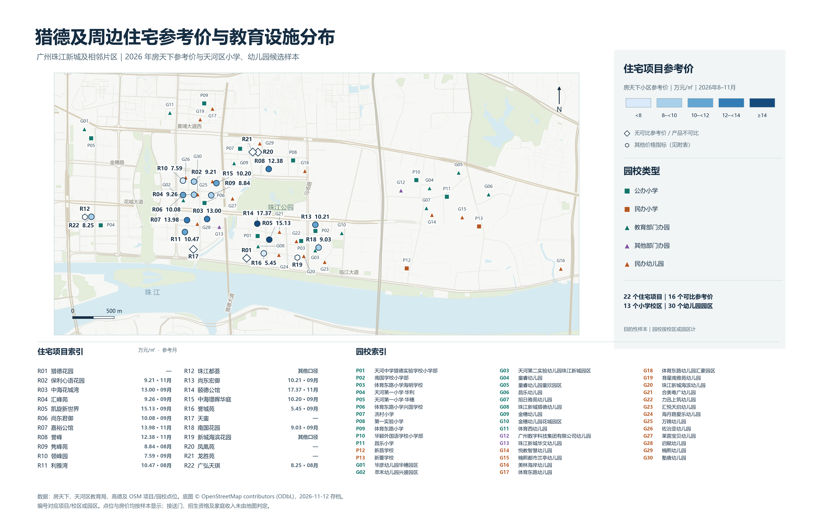
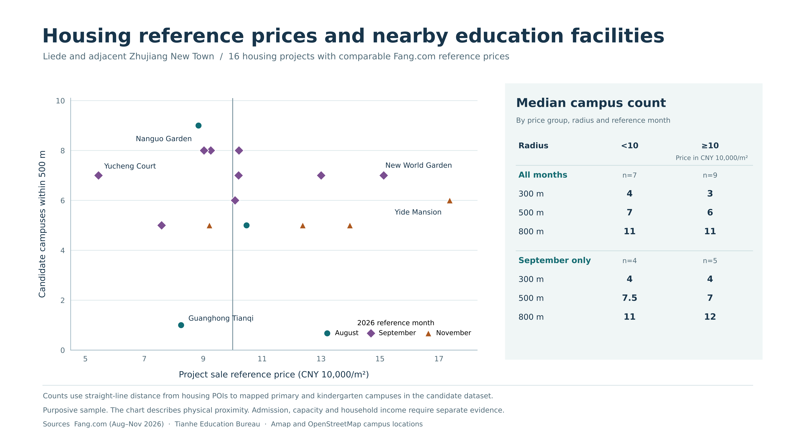
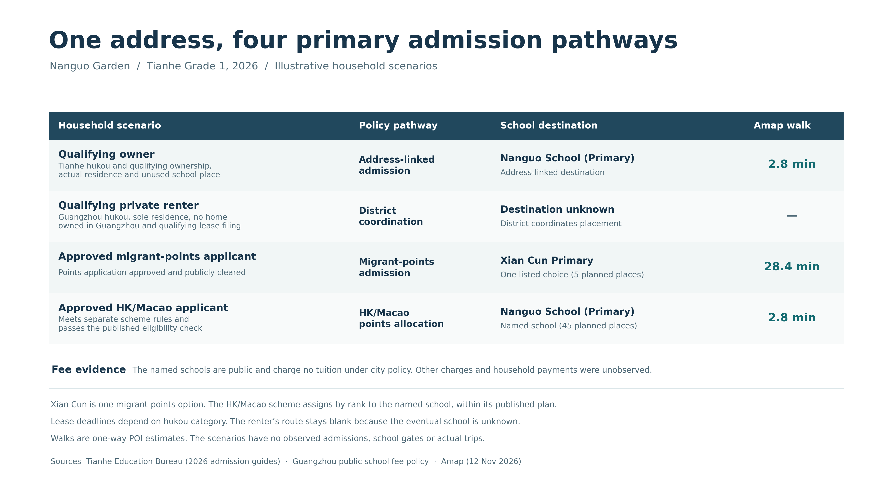
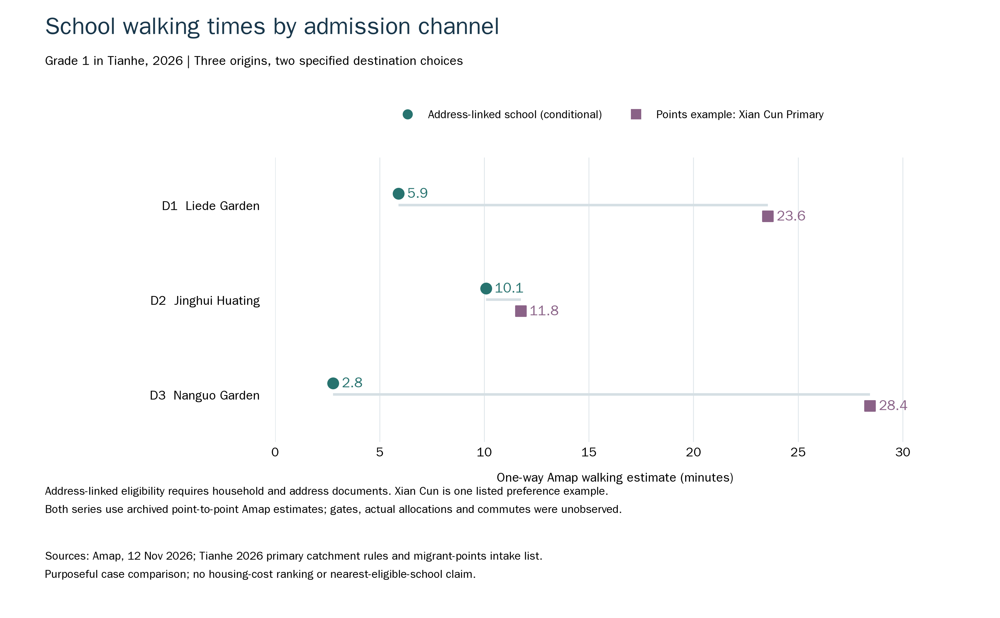
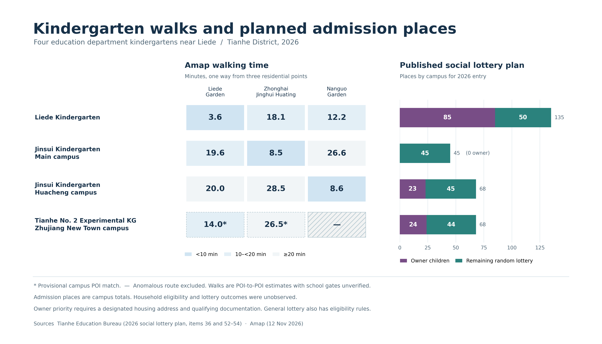

# 住得近，就能读得上吗？

**猎德小学与幼儿园研究 · 组员资料交接 · 2026年11月13日**

我们把各专题收集的住房、园校、招生、收费、交通、现场和文献资料放在同一个阅读入口，并把能够对应的对象连接起来，供理论组和报告组继续分析：**猎德及周边小学、幼儿园的空间分布，如何与招生资格、收费和家庭住房条件相互作用，影响不同家庭获得教育资源的机会？**

**先看本页了解研究材料和综合发现，再下载[中文资料与数据工作簿](交接资料/研究资料与综合数据.xlsx)。** 第一张表是「资料清单」，能按领域筛选、查看内容并点击原件；后面的表已整理好住宅、园校、价格、招生、收费与路线，不需要运行程序。[逐项文件目录](交接资料/资料目录.md)也可直接在GitHub阅读。

## 我们已经有什么资料

现用空间资料包含 **22个住宅项目、13个小学校区、30个幼儿园园区**，都有地图参照位置；保留 **66条不同口径、时期的住房观察**。深入的招生渠道与步行案例集中在**猎德花园、中海璟晖华庭、南国花园**三个起点，保留42条路线原记录，其中1条异常排除、2条仅作带标识补充。不能把22个有位置的住宅都当成有路线、家庭资格和收费调查的样本。

|资料领域|已经收集到什么|打开哪里，怎样使用|
|---|---|---|
|**住宅与住房成本**|住宅地址、住房性质原描述、平台项目参考价、个案出售挂牌、整租、人才配租及价格复核|工作簿「住宅综合」「住房观察」；[原房价调查](04_工作区/研究分析/房价分布/README.md)。按指标和月份选择，不能把租金、参考售价和个案混排|
|**小学与幼儿园**|43条候选园校的地址、学段、办学类别、机构与校区对应、位置和匹配备注；另有更大范围原始名录|工作簿「园校综合」；[教育专题材料](03_背景/教育专题/README.md)。当前43条是候选清单，不是片区完整普查|
|**招生资格与名额**|2026小学地段、户籍与住房条件、租户／安置户统筹、来穗积分、港澳单列及幼儿园配套优先与随机派位|工作簿「招生规则」「招生计划」「渠道条件」「同址案例」。规则、校区计划和个人录取分开|
|**收费与减免**|公办义务教育收费规则、民办小学官方批复、幼儿园收费政策、历史报价和有条件减免；逐园当期费用仍有缺口|工作簿「收费证据」；[收费核验原材料](03_背景/教育专题/招生渠道与费用核验.md)。证据层级逐行保留，未知不填零|
|**步行与交通**|三个住宅的指定园校路线、高德原始秒数／米数、起终点、公交情境、步速敏感性与异常记录|工作簿「步行路线」；[交通专题](04_工作区/研究分析/交通可达性/README.md)。看起终点和样本范围；不是家庭实走|
|**综合空间资料**|新完整地图、裁切图、价格复核、位置对应，以及300／500／800米候选园校计数|本页配图、工作簿「附近园校」「直线距离」；[空间研究原报告](04_工作区/研究分析/图表与数据补充/ucug3801-housing-education-spatial/spatial-findings-report.md)|
|**补证、证据链与缺口**|45条定向补证、官方来源及核验状态、逐项研究发现和历史累计问题登记|工作簿「证据索引」「来源登记」「研究缺口」；[补证原报告](04_工作区/研究分析/定向证据补全/2026-11-13/new-evidence-report.md)。历史问题不全是当前未解决问题|
|**现场材料**|4张建筑／雕塑照片、2张学校地图检索截图、现场指导问题及观察模板|[照片](02_现场/照片)、[检索截图](02_现场/地图检索)、[现场说明](02_现场/现场记录与说明.md)。尚不足以支持家庭经验、通学实测或访谈结论|
|**文献与课程概念**|猎德社会分层与教育资源的文献综述、研究框架，以及城市更新、产权、公共服务的既有阅读和原件|[文献综述Word](04_工作区/研究分析/文献综述/猎德社会分层与教育资源分配_文献综述与研究框架.docx)、[文献阅读与引用](04_工作区/研究分析/04_文献阅读与引用.md)、[课程阅读](03_背景/课件与阅读索引.md)。供理论组判断解释，文献案例不等于本组观测|
|**研究方案与历史资料**|当前教育选题方案；前期产权、公共文化服务选题、旧地图与海报|[当前研究方案](04_工作区/研究分析/07_当前方向_教育设施分布与教育机会不平等.md)、[历史资料库](03_背景/资料库/资料索引.md)、[逐项目录](交接资料/资料目录.md)。历史材料原位保留，未自动纳入教育结论|
|**作业要求**|作业PDF、Canvas快照、评分与范围勘误|[作业要求整理](01_作业要求/作业要求整理.md)。本研究仅小学与幼儿园，不要求比较两个社区；提交配置以课程确认信息为准|

表中呈现的是已有材料，不是必读清单。要找某住宅，先筛「住宅综合」，再在「住房观察」「渠道条件」「步行路线」筛相同住宅名称；要找某园校，先筛「园校综合」，再查「招生计划」「收费证据」。每张表都留有出处和编号供回查。

## 1．住宅与园校：先看空间上有什么，再问谁能使用

**图注。** 22个目的性住宅项目和43个已定位候选园校（13小学、30幼儿园）。蓝色色阶仅使用16个房天下项目月参考价，时期为2026年8—11月，单位万元／平方米；空心住宅标记表示其他口径、产品不可比或缺参考价。园校符号区分学段和办学类别。位置是地图参照，未证明实际校门；底图为OpenStreetMap存档。完整范围覆盖猎德及珠江新城相关周边，不能视为猎德街道行政边界或设施完整清单。

[下载完整图PDF](交接资料/图表/01_住房与园校分布_完整图.pdf) · [可编辑SVG](交接资料/图表/01_住房与园校分布_完整图.svg) · [海报裁切图](交接资料/图表/02_住房与园校分布_裁切图.png) · [原始定位与价格表](04_工作区/研究分析/图表与数据补充/ucug3801-housing-education-spatial/data)。**新完整图正式替代旧整合图A。** 海报裁切图是同一资料的较窄视图：22住宅、9小学、22幼儿园；其余候选仍参与完整空间分析。

价格较高的住宅在本样本中并不稳定地拥有更多近邻候选园校。以10万元／平方米作描述性分组切点，两组的候选园校总数中位数如下：

|直线半径|低于10万元／平方米|达到10万元／平方米|
|---|---:|---:|
|300米|4|3|
|500米|7|6|
|800米|11|11|

只取9月参考价时，800米的比较变为11／12。它说明**分组结果对月份和半径敏感**，不支持稳定的“价高就有更多附近园校”结论。住宅区位、楼龄、产品和名录选样也可能共同影响图面；不能由此推断学校推高房价，或以参考价替代家庭收入。数据见工作簿「住宅综合」「附近园校」，[原汇总表](04_工作区/研究分析/图表与数据补充/ucug3801-housing-education-spatial/data/price_proximity_summary.csv)。

展开：参考价与附近园校比较图

16个同平台项目月参考价；附近数按已定位候选清单计，不是学位数、学校质量或可申请数。[原图说明](04_工作区/研究分析/图表与数据补充/ucug3801-composite-figures/supplementary-figure-notes.md)。

## 2．同一住址：家庭材料不同，申请渠道可能不同

以**南国花园**为固定起点，制度材料可以连接出四种情境：

|家庭情境|可以怎样解释政策渠道|目的地与路线证据|
|---|---|---|
|满足完整地段条件的业主|核户籍、产权、实际居住、学位占用等，不能仅凭买房判断|地段对应南国学校小学部；高德166秒，约2.8分钟|
|符合条件的穗籍私房租户|核全市无房、唯一住址、租赁备案等，按规则统筹|统筹去向未观察；不填学校或步行零值|
|获准来穗积分申请人|按当年名单、积分和志愿申请；原四所样本小学不在该公办计划内|冼村小学是名单内一个志愿例；1706秒，约28.4分钟，不是实际分配|
|通过港澳单列渠道审核的申请人|公示后按积分排名安排，直至45个一年级名额用完|指定南国学校小学部，与地段目的地重合；路线同为166秒|

这是规则情境，**不是四户受访家庭，也没有观察到实际录取**。南国花园两条指定路线差1540秒，约25.7分钟；它可说明渠道对应目的地可能带来的时间差，不能代表所有家庭的平均通学成本或最近可申请距离。[2026小学细则附件5、9](https://www.thnet.gov.cn/attachment/8/8016/8016210/10791180.pdf) · [来穗公办小学计划](https://www.thnet.gov.cn/attachment/8/8040/8040292/10872346.xls) · [港澳小学指引](https://www.thnet.gov.cn/gzjg/qzf/qjyj/zsks/content/post_10833283.html)。逐项条件、路线和原文定位已收入工作簿「同址案例」。

三处住宅另有同口径的两目的地比较，适合展示“固定起点、改变渠道相关目的地”的情境：

|住宅起点|条件性地段对应小学|单程步行|冼村小学志愿例|原始秒数算出的差值|
|---|---|---:|---:|---:|
|猎德花园|猎德实验学校小学部|5.9分钟|23.6分钟|+17.6分钟|
|中海璟晖华庭|体育东路小学兴国学校|10.1分钟|11.8分钟|+1.7分钟|
|南国花园|南国学校小学部|2.8分钟|28.4分钟|+25.7分钟|

两组都是高德POI到POI单程估算。地段学校须满足完整家庭条件；冼村小学是一个名单内示例，未证明为最近可申请校。分钟和差值分别从原始秒数四舍五入，不能用舍入后数值倒算。三住宅路线图与上面的四类家庭图用途互补，继续保留；[PDF](交接资料/图表/06_三住宅招生渠道与步行比较.pdf)／[SVG](交接资料/图表/06_三住宅招生渠道与步行比较.svg)。

## 3．幼儿园：走得近、业主优先和派位名额是三种证据

|2026园区小班计划|业主子女名额|剩余随机派位名额|
|---|---:|---:|
|猎德幼儿园|85|50|
|金穗幼儿园本园|0|45|
|金穗幼儿园花城园区|23|45|
|天河第二实验幼儿园珠江新城园区（K7）|24|44|

名额来自[官方园区招生计划第36、52—54项](https://www.thnet.gov.cn/gzjg/qzf/qjyj/zsks/content/post_10815546.html)。它们属于园区，不能因为三处住宅都连到同一园而相加，也不能按住宅远近分配。**金穗本园当年公布业主名额为0**；符合一般条件者仍可参加一般派位。其他配套园区的优先资格仍需当年门牌与家庭材料。[幼儿园招生方案](https://www.thnet.gov.cn/gzjg/qzf/qjyj/zsks/content/post_10777181.html)。

原六园固定样本中，按高德时间，三个起点均可在10分钟内到达一所教育部门办园；将同一路线米数按1.00米／秒重算，只剩猎德花园，3／3变为1／3。补查普惠性民办海滨园后，南国花园到**扩展后已测候选**最近幼儿园从388秒（约6.5分钟）变为238秒（约4.0分钟）。这些结果分别依赖样本和步速，不能互换分母，更不是全片区最近园或可录取园。[原六园敏感性表](06_数据整合/outputs/data/walking_sensitivity.csv) · [海滨园官方分类](https://www.thnet.gov.cn/gzjg/qzf/qjyj/zsks/content/post_10815624.html)。

D3→K7原18米短于端点约51.6米直距，继续排除，**有效路线仍缺**。K7能在新图上定位，不等于异常路线已修复。D1／D2到K7两条旧名地址匹配路线，只可带标识补充使用。

## 4．收费：制度有差异，家庭实际负担仍未知

|现有证据|可使用的数字／规则|不能推出什么|
|---|---|---|
|公办小学政策|免学费，服务或代收费等另核|教育总支出不等于零|
|新蕾小学官方批复|8000元／生／学期，适用期覆盖2026学年|未证明样本家庭就读或实际净缴此金额|
|新昌小学官方批复|8700元／生／学期，适用期覆盖2026学年|批复、实收、补贴抵扣不能混为一项|
|学前一年减免|符合条件的大班／相应混龄班保教费减免，伙食等另计|不能直接套入2026年新小班|
|核心幼儿园小班|保留历史或推定证据；当期保教、伙食与实缴仍缺|不能用“公办”“普惠”或历史报价判定可负担|

[公办小学收费政策](https://fgw.gz.gov.cn/ztzl/gzsfzggwzdlyxxgkzl/content/post_10506743.html) · [新蕾批复](https://fgw.gz.gov.cn/tzgg/ywgg/content/post_10414690.html) · [新昌批复](https://fgw.gz.gov.cn/gkmlpt/content/9/9758/post_9758311.html) · [学前减免问答](https://jyj.gz.gov.cn/gk/zfxxgkml/bmwj/qtwj/content/post_10516322.html)。工作簿「收费证据」逐行分开政策、批复、历史、推定、减免条件及未收集状态；未观察的家庭净支出保留空白。

## 后续组员怎样接着用

- **理论组：** 把“近邻供给—制度资格—费用／时间条件”作为可讨论的机制链，再结合既有文献选择概念。当前证据支持说明部分机会条件，尚不能证明社会再生产、隔离或住房的因果效应。
- **报告组：** 从工作簿按名称筛选需要的案例；保留指标、年份、条款定位及限制。资料清单还列出了未选入上述发现的原件、文献、现场材料和历史方向，便于自行判断。
- **Poster负责人：** [图表文件夹](交接资料/图表)提供现用PNG、PDF和可编辑SVG。本页每图后的中文图注可直接改写引用；英文图面保持原作者版本。新完整空间图替代旧图A，裁切图供版面选择；没有修改已有Poster文件。

共同局限是目的性选样、候选名录覆盖不均、平台混合月份报价、未核实际门点及接送时段；没有家庭收入／预算、完整资格材料、申请与录取结果、逐户实缴及学校质量观察。租户统筹去向、核心园区配套门牌和小班当期费用仍缺。兴国学校的条件性容量预警须按年份引用：2025细则针对2026，2026细则针对2027，未观察到2026实际超额触发。

## 图和资料以哪个版本为准

**本页＋中文工作簿＋「交接资料／图表」是当前统一交接入口。** 新图包的22住宅、43园校、66住房观察，已与上一轮核对过的招生、收费、42条路线接入同一工作簿；原18住宅及43园校编号均沿用。珠江都荟的挂牌页面均值口径已更正并保留旧指标，新增住宅没有补造路线或申请结果。

旧图A、旧定位覆盖数字（住宅5／18、园校26／43）和旧简报的空间段落留作历史，**请勿与本页统计混用**。原始图包、专题原件和他人报告均原位保留。具体替换与互补关系见工作簿「图表与版本」；完整材料目录见[这里](交接资料/资料目录.md)。

仅供数据维护者：来源、复现与历史基线

交接版本：**中文交接版-2026-11-13-v1**。[版本与核对记录](交接资料/交接版本与核对记录.json)记录输入、图件和工作簿版本。资料目录仅列已纳入Git的材料，未把其他组员本机未提交稿发布为本轮成果。

[维护说明](06_数据整合/maintenance/维护说明.md)解释如何重新导出中文工作簿。Python用于幕后匹配、整理和核查；阅读、引用和制作Poster无需运行它。上一轮标准化CSV和管线保留在[技术模块](06_数据整合/README.md)，其中空间表是历史基线；本次没有改写那些原表。

[原始ZIP](UCUG3801-maps-and-data.zip)及[原样展开目录](04_工作区/研究分析/图表与数据补充)均保留；原包内脚本针对旧提交，不作为普通组员的使用入口。原首页与旧版说明可通过Git历史查阅。

